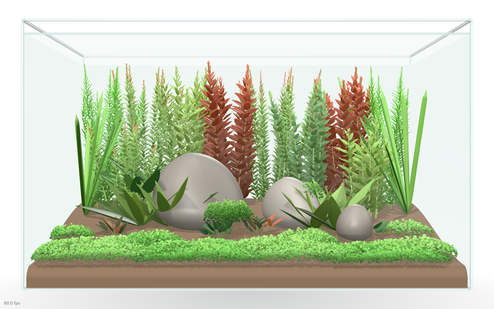
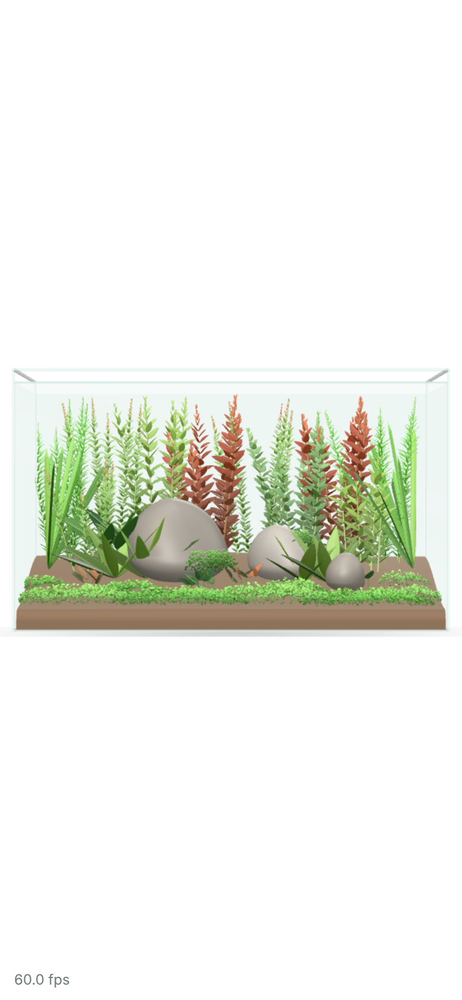
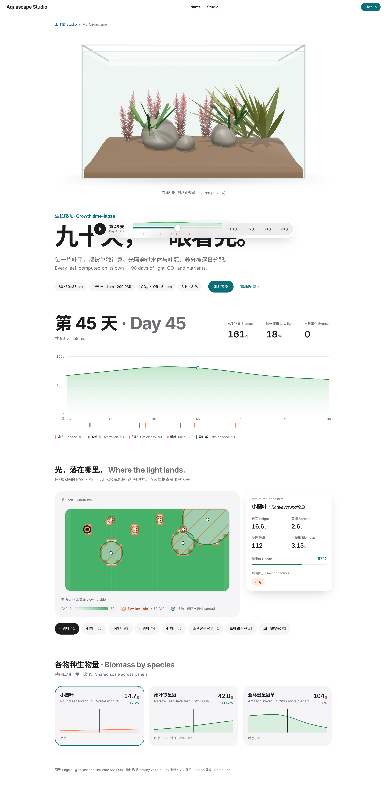
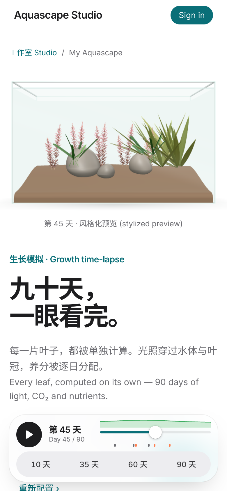

# 迭代日志 · 2026-11-12 第 2 轮（太平洋时间）

> 同一天的第二次定时运行。补课已在第 1 轮完成（见 [2026-11-12.md](./2026-11-12.md)），本轮开始 P2：正面视角风格化水缸 (stylized frontal tank)。

## 开始时检查
- Xiaopu 的待确认项：无新回复。Design 画布 v3 · 超白玻璃：无评论。
- AWS 资源 PR：[infra#1](https://github.com/aquascape-studio/aquascape-infra/pull/1)（dev 降本到约 $5/月：去 NAT、去 ALB、Fargate Spot、定时缩到 0）是 lixiangdapanji 账号开的，PR 描述写明**已部署到 dev**，但没有 Xiaopu 的批准评论 → 本轮**不合并**，留给 Xiaopu 处理。注意：按这个 PR，dev 的 web/sim 只在每天 01:30–04:00 PT 运行。

## 调研 (research)，今天的角度：风格化 3D 植被渲染
- MeshPhysicalMaterial 的 `transmission` 会把所有不透明物体再渲染一遍进透射缓冲区，代价随场景整体增长；论坛建议植被用实例化 (instancing) + 便宜材质，在 shader 里加背光项 (back-light term) 来假装透光。→ 我们叶片**不用 transmission**，用 onBeforeCompile 加 wrap/back-light 项。
  - https://discourse.threejs.org/t/meshphysicalmaterial-can-i-measure-how-much-more-expensive-it-is/60398
  - https://discourse.threejs.org/t/draw-call-and-triangles-amount-increases-when-having-a-physical-material-with-transmission/46663/4
  - https://discourse.threejs.org/t/procedural-instanced-forest-high-performance-real-trees/88610
- 风格化草地：实例化叶片、伪环境光遮蔽 (fake AO)、逐实例颜色变化 → 采用"每株深浅渐变 + 嫩梢更亮"。
  - https://tympanus.net/codrops/2025/02/04/how-to-make-the-fluffiest-grass-with-three-js/（沙盒无法直连 tympanus.net，只看到搜索摘要）
  - https://tympanus.net/codrops/2025/07/10/three-js-instances-rendering-multiple-objects-simultaneously/

## 需求
总 issue：[studio#4](https://github.com/aquascape-studio/aquascape-studio/issues/4) — 正面视角风格化水缸，由 sim 帧驱动 + sim-core 契约 v1.1。
子 issue：[sim#4](https://github.com/aquascape-studio/aquascape-sim/issues/4)、[render#1](https://github.com/aquascape-studio/aquascape-render/issues/1)、[botany#4](https://github.com/aquascape-studio/aquascape-botany/issues/4)、[web#4](https://github.com/aquascape-studio/aquascape-web/issues/4)。

## 契约 (contracts, orchestrator)
| 契约 | 版本 | PR |
|---|---|---|
| sim-core `ts/src/contract.ts`：`parDailyMean`、`Frame.substrate` 底床余量网格、`cancelled` 回执、事件 7 天重新触发规则、包络规则 | 1.1.0 → 1.1.1（sim-agent 指出光照轴上平台是 0.7，已更正） | [sim#5](https://github.com/aquascape-studio/aquascape-sim/pull/5)、[sim#7](https://github.com/aquascape-studio/aquascape-sim/pull/7) |
| render `src/contract.ts`：`FrontalTankProps` / `SpeciesLook` / `PlantVisual` / `speciesLook()` | 1.0.0 → 1.0.1（render-agent 的 4 条异议：坡形底床偏移、漂浮植物在水面、botany tipColorHex 优先、JSX 类型） | [render#2](https://github.com/aquascape-studio/aquascape-render/pull/2)、[render#4](https://github.com/aquascape-studio/aquascape-render/pull/4) |
| botany schema：可选 `visual` 块（leafShape / arrangement / leafLengthCm / leafWidthCm / leafDensity / tipColorHex） | — | [botany#5](https://github.com/aquascape-studio/aquascape-botany/pull/5) |

## 各 agent 结果
| agent | 模型 | 仓库 | 结果 | PR |
|---|---|---|---|---|
| sim-agent | opus | aquascape-sim | 实现 v1.1：`parDailyMean`、逐格底床余量（no3/po4/k/fe 平均剩余比例，新鲜 aquasoil 第 120 天耗尽 97.8%）、Worker `cancelled` 回执、事件按 (植株, 类型, 细节) 7 天重新触发。旧字段输出逐字节不变；parity 4.4e-16；90 天×30 株 冷 75–107 ms / 热 17–30 ms；41 测试通过 | [sim#6](https://github.com/aquascape-studio/aquascape-sim/pull/6) ✅ |
| botany-agent | sonnet | aquascape-botany | 78 种全部补 `visual`；8 种叶片尺寸有来源，70 种为估计值（统一引用 `visual-estimate-2026`，待复核）；18 种红色系加 `tipColorHex`；版本 0.3.0 | [botany#6](https://github.com/aquascape-studio/aquascape-botany/pull/6) ✅ |
| render-agent | opus | aquascape-render | `<FrontalTank>` + `speciesLook()`：实例化圆润厚叶片（高画质约 4.1 万片，低画质约 1.7 万片）、shader 背光假透光、纯白影棚、只正面相机、光滑卵石、坡形底床、健康度低会发黄变稀；peer 依赖升到 three ≥0.170 / fiber 9 / drei 10 / React 19；13 测试 | [render#3](https://github.com/aquascape-studio/aquascape-render/pull/3) ✅ |
| app-agent | opus | aquascape-web | 新开关 `stylizedTank`（`NEXT_PUBLIC_FF_STYLIZED_TANK`，默认关）；/studio/sim 顶部显示正面水缸，随时间轴生长；`lib/sim/toFrontal.ts` 映射 + 默认三块石头；重新 vendoring sim-core 1.1.1 + botany（含 visual）；开关关闭时页面不变、不加载 three；两种开关状态 typecheck / 33 测试 / build 通过 | [web#5](https://github.com/aquascape-studio/aquascape-web/pull/5) ✅ |

## 截图（stylizedTank 开关打开，第 45 天）— 请 Xiaopu 确认视觉
- 组件 demo（30 株、第 45 天风格的满缸，桌面）：
- 组件 demo（手机，自动低画质）：
- /studio/sim 页面（开关打开，第 45 天，默认 8 株的缸）桌面：
- 同上，手机：
- 注意：默认缸只有 8 株、3 种、没有前景草毯，CO₂ 关闭，所以页面里看着偏稀、小圆叶 (Rotala rotundifolia) 发粉；demo 图才是满缸的样子。桌面整页截图里磨砂控制条压在标题上，是 sticky 控制条在整页截图里的位置造成的，不是真实浏览效果。

## 部署
- aquascape-web main（2d482c4，含 render main 5a9356e）→ GitHub Actions [run 43202606823](https://github.com/aquascape-studio/aquascape-web/actions/runs/43202606823)：第一次 deploy 失败在 `next/font` 拉 Google Fonts（与改动无关，PR 上同样构建为绿），重跑失败的 job 一次后 build ✅、deploy ✅（ECR 推镜像 + ECS `aquascape-web-dev` 更新服务）。
- 线上地址 https://efferves.live/studio/sim —— `stylizedTank` 未在部署里打开，线上页面与之前一致（只多了 sim-core 1.1.1 引擎）。
- ⚠️ 线上验证未完成：沙盒访问 efferves.live 仍失败（网络策略），无法确认页面可访问。另外按 infra#1 的说法 dev 只在 01:30–04:00 PT 运行。
- sim / botany / render 的 main CI 均为绿色。

## 方向性决定及理由
1. **P2 先做"正面风格化渲染"，拖拽编辑和模板放后面**：时间轴已经上线，用户最缺的是"看见缸长起来"的画面；渲染组件做好后编辑器可以复用。
2. **叶片不用 transmission**：调研显示 transmission 会让整个场景多渲染一遍，4 万片叶子的实例化场景扛不住；用 shader 背光项假装透光。
3. **sim-core v1.1 纯增量**：旧字段输出逐字节不变（parity 4.4e-16），web 的 vendored 副本可以直接升级。
4. **botany 叶片尺寸先估后补**：78 种里只有 8 种找到可引用的叶片尺寸（Wikipedia / Tropica / efloras 在沙盒里 DNS 失败），70 种用估计值并引用同一条 `visual-estimate-2026`（bib 里注明待复核）。这些值只影响画面，不进生长模拟，所以先合并。
5. **infra#1 不合并**：不是本会话开的、没有 Xiaopu 批准记录，按规则涉及删除 AWS 资源（NAT、ALB）必须等他。

## 失败 / 未完成
- botany：70/78 种叶片尺寸是估计值（Wikipedia、Tropica、efloras 在沙盒里 DNS 失败）。只影响画面，需要在网络放行后补一轮来源。
- render：没有在真 GPU 上测帧率（无头 SwiftShader 不具参考性）；每次属性更新重算布局约 16 ms（高画质），拖动时间轴可能达不到 30 次/秒，下一步缓存逐叶随机数；阴影不随摆动；茎草有点像"鱼骨"，石头偏蛋形，背光透光偏弱，前沿底床太素。
- web：默认缸偏稀（为保证开关关闭时页面不变，没改默认配置）；`THREE.Clock` 弃用警告；契约异议：`exactOptionalPropertyTypes` 下可选属性不能传 `undefined`、render 的 dist 导入应带 `.js` 后缀 → 明天 render 契约 1.0.2 处理。
- 部署：第一次部署构建失败在 `next/font` 拉取 Google Fonts（Noto Sans SC）时，与本次改动无关（PR 上同样的构建是绿的），重跑一次；结果见"部署"。
- 线上验证：沙盒仍无法访问 efferves.live（网络策略），无法从这里确认页面。
- e2e：总仓 smoke 测试仍断言旧的 ink-green 首页，未运行。

## 用量
4 个子 agent（sim: opus ~3 min；botany: sonnet ~2.5 min；render: opus ~23 min；web: opus ~17 min）+ orchestrator。本轮总耗时约 1 小时。

## 明天的建议
1. 等 Xiaopu 确认正面水缸视觉，认可后打开 `NEXT_PUBLIC_FF_STYLIZED_TANK`。
2. render 打磨：茎草叶序更自然、石头造型更雕塑感、背光加强、前沿底床加细沙纹理；布局缓存让拖动达到 30 次/秒；契约 1.0.2。
3. 默认缸换成满缸模板（前景草毯 + 中景 + 后景红绿茎草），作为 P2 模板（Iwagumi / Nature / Dutch）的第一个。

## 追加：Xiaopu 授权"该合并合并"
- Xiaopu 回复："该合并合并 不用等我approve 我一周之后来看成果"。
- [infra#1](https://github.com/aquascape-studio/aquascape-infra/pull/1) 已合并（CI 绿；infra 部署是手动触发，合并本身不改 AWS；内容作者说已部署到 dev）。
- [web#6](https://github.com/aquascape-studio/aquascape-web/pull/6) 在部署构建里打开 `NEXT_PUBLIC_FF_STYLIZED_TANK`；[run 43269865567](https://github.com/aquascape-studio/aquascape-web/actions/runs/43269865567) build ✅ deploy ✅。线上 /studio/sim 顶部现在显示正面水缸。
- 长期授权写进 ROADMAP。
