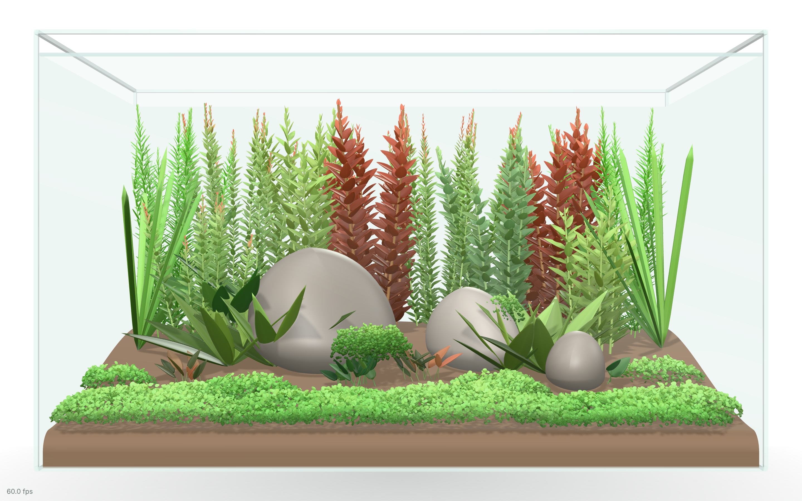
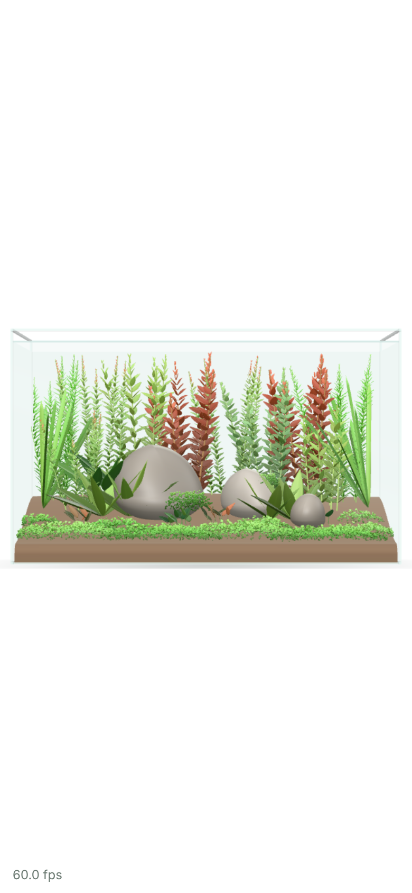
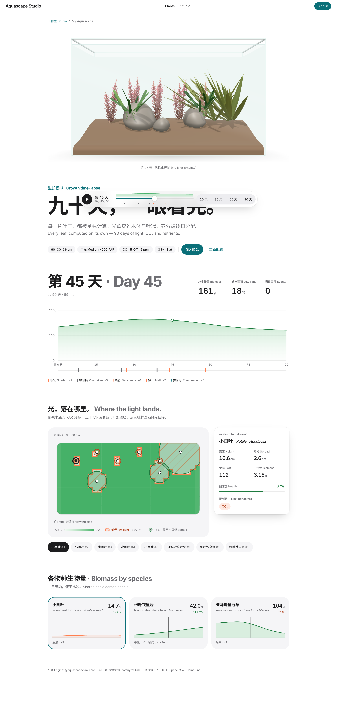
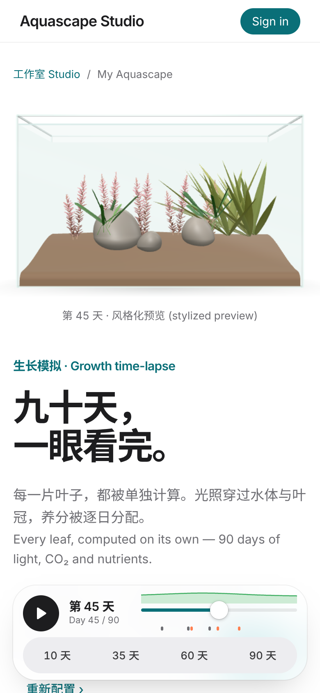

# Iteration log · 2026-11-12 round 2 (Pacific Time)

> The second scheduled run of the same day. Catch-up was completed in round 1 (see [2026-11-12.md](./2026-11-12.md)); this round starts P2: the stylized frontal tank.

## Checks at start
- Xiaopu's pending items: no new replies. Design canvas v3 · Ultra-white glass: no comments.
- AWS resource PR: [infra#1](https://github.com/aquascape-studio/aquascape-infra/pull/1) (dev cost cut to about $5/month: no NAT, no ALB, Fargate Spot, scheduled scale-to-0) was opened from the lixiangdapanji account; the PR description says it is **already deployed to dev**, but there is no approval comment from Xiaopu → this round it was **not merged**, left for Xiaopu to handle. Note: per this PR, dev's web/sim only run daily 01:30–04:00 PT.

## Research, today's angle: stylized 3D vegetation rendering
- MeshPhysicalMaterial `transmission` re-renders all opaque objects into a transmission buffer, with cost growing with the whole scene; forums recommend instancing + a cheap material for vegetation, adding a back-light term in the shader to fake translucency. → Our leaves **do not use transmission**; we add a wrap/back-light term with onBeforeCompile.
  - https://discourse.threejs.org/t/meshphysicalmaterial-can-i-measure-how-much-more-expensive-it-is/60398
  - https://discourse.threejs.org/t/draw-call-and-triangles-amount-increases-when-having-a-physical-material-with-transmission/46663/4
  - https://discourse.threejs.org/t/procedural-instanced-forest-high-performance-real-trees/88610
- Stylized grass: instanced blades, fake ambient occlusion (fake AO), per-instance color variation → we adopt "a dark-to-light gradient per plant + brighter new tips".
  - https://tympanus.net/codrops/2025/02/04/how-to-make-the-fluffiest-grass-with-three-js/ (the sandbox cannot reach tympanus.net directly; only the search snippet was seen)
  - https://tympanus.net/codrops/2025/07/10/three-js-instances-rendering-multiple-objects-simultaneously/

## Requirements
Umbrella issue: [studio#4](https://github.com/aquascape-studio/aquascape-studio/issues/4) — frontal stylized tank, driven by sim frames + sim-core contract v1.1.
Sub-issues: [sim#4](https://github.com/aquascape-studio/aquascape-sim/issues/4), [render#1](https://github.com/aquascape-studio/aquascape-render/issues/1), [botany#4](https://github.com/aquascape-studio/aquascape-botany/issues/4), [web#4](https://github.com/aquascape-studio/aquascape-web/issues/4).

## Contracts (orchestrator)
| Contract | Version | PR |
|---|---|---|
| sim-core `ts/src/contract.ts`: `parDailyMean`, `Frame.substrate` remaining-substrate grid, `cancelled` receipt, 7-day event re-trigger rule, envelope rule | 1.1.0 → 1.1.1 (sim-agent pointed out that the plateau on the light axis is 0.7; corrected) | [sim#5](https://github.com/aquascape-studio/aquascape-sim/pull/5), [sim#7](https://github.com/aquascape-studio/aquascape-sim/pull/7) |
| render `src/contract.ts`: `FrontalTankProps` / `SpeciesLook` / `PlantVisual` / `speciesLook()` | 1.0.0 → 1.0.1 (render-agent's 4 objections: sloped-bed offset, floating plants at the water surface, botany tipColorHex takes priority, JSX types) | [render#2](https://github.com/aquascape-studio/aquascape-render/pull/2), [render#4](https://github.com/aquascape-studio/aquascape-render/pull/4) |
| botany schema: optional `visual` block (leafShape / arrangement / leafLengthCm / leafWidthCm / leafDensity / tipColorHex) | — | [botany#5](https://github.com/aquascape-studio/aquascape-botany/pull/5) |

## Results per agent
| agent | model | repo | result | PR |
|---|---|---|---|---|
| sim-agent | opus | aquascape-sim | Implemented v1.1: `parDailyMean`, per-cell substrate remainder (no3/po4/k/fe average remaining fraction; fresh aquasoil 97.8% depleted on day 120), Worker `cancelled` receipt, events re-triggered every 7 days per (plant, type, detail). Old field output byte-for-byte unchanged; parity 4.4e-16; 90 days × 30 plants cold 75–107 ms / warm 17–30 ms; 41 tests pass | [sim#6](https://github.com/aquascape-studio/aquascape-sim/pull/6) ✅ |
| botany-agent | sonnet | aquascape-botany | All 78 species given `visual`; 8 species have sourced leaf dimensions, 70 are estimates (all citing `visual-estimate-2026`, to be reviewed); 18 red-toned species given `tipColorHex`; version 0.3.0 | [botany#6](https://github.com/aquascape-studio/aquascape-botany/pull/6) ✅ |
| render-agent | opus | aquascape-render | `<FrontalTank>` + `speciesLook()`: instanced rounded thick leaves (about 41k blades at high quality, about 17k at low), shader back-light faking translucency, pure white studio, frontal camera only, smooth pebbles, sloped substrate bed, low health makes plants yellow and thin out; peer dependencies raised to three ≥0.170 / fiber 9 / drei 10 / React 19; 13 tests | [render#3](https://github.com/aquascape-studio/aquascape-render/pull/3) ✅ |
| app-agent | opus | aquascape-web | New flag `stylizedTank` (`NEXT_PUBLIC_FF_STYLIZED_TANK`, off by default); /studio/sim shows the frontal tank at the top, growing with the timeline; `lib/sim/toFrontal.ts` mapping + three default rocks; re-vendored sim-core 1.1.1 + botany (with visual); with the flag off the page is unchanged and three is not loaded; typecheck / 33 tests / build pass in both flag states | [web#5](https://github.com/aquascape-studio/aquascape-web/pull/5) ✅ |

## Screenshots (stylizedTank flag on, day 45) — please have Xiaopu confirm the visuals
- Component demo (30 plants, a full tank in day-45 style, desktop): 
- Component demo (mobile, automatic low quality): 
- /studio/sim page (flag on, day 45, default 8-plant tank) desktop: 
- Same, mobile: 
- Note: the default tank has only 8 plants, 3 species, no foreground carpet, and CO₂ off, so it looks sparse on the page and the small round leaf (Rotala rotundifolia) turns pink; the demo images show what a full tank looks like. In the desktop full-page screenshot the frosted control bar sits on top of the headline; this is where the sticky control bar lands in a full-page screenshot, not what real browsing looks like.

## Deployment
- aquascape-web main (2d482c4, including render main 5a9356e) → GitHub Actions [run 43202606823](https://github.com/aquascape-studio/aquascape-web/actions/runs/43202606823): the first deploy failed fetching Google Fonts in `next/font` (unrelated to the change; the PR's build was green too); after re-running the failed job once, build ✅, deploy ✅ (image pushed to ECR + ECS `aquascape-web-dev` service updated).
- Live URL https://efferves.live/studio/sim — `stylizedTank` was not turned on in the deployment, so the live page is the same as before (only the sim-core 1.1.1 engine was added).
- ⚠️ Live verification not completed: the sandbox still fails to access efferves.live (network policy), so the page's accessibility could not be confirmed. Also, per infra#1 dev only runs 01:30–04:00 PT.
- Main CI for sim / botany / render is green.

## Directional decisions and rationale
1. **P2 starts with "frontal stylized rendering", with the drag editor and templates later**: the timeline is already live, and what users miss most is "seeing the tank grow"; once the rendering component is done, the editor can reuse it.
2. **Leaves do not use transmission**: research shows transmission makes the whole scene render an extra time, and an instanced scene with 40k leaves cannot handle that; a shader back-light term fakes the translucency.
3. **sim-core v1.1 is purely additive**: old field output is byte-for-byte unchanged (parity 4.4e-16), so web's vendored copy can be upgraded directly.
4. **botany leaf dimensions are estimated first, sourced later**: of the 78 species only 8 had citable leaf dimensions (Wikipedia / Tropica / efloras fail DNS in the sandbox); 70 use estimates citing the same `visual-estimate-2026` (the bib notes they are pending review). These values only affect visuals and do not enter the growth simulation, so it was merged first.
5. **infra#1 not merged**: it was not opened by this session and has no Xiaopu approval record; under the rules, anything that deletes AWS resources (NAT, ALB) must wait for them.

## Failures / unfinished
- botany: 70/78 species' leaf dimensions are estimates (Wikipedia, Tropica, efloras fail DNS in the sandbox). This only affects visuals; a round of sourcing is needed once the network is opened up.
- render: frame rate was not tested on a real GPU (headless SwiftShader is not representative); recomputing the layout on every prop update takes about 16 ms (high quality), so dragging the timeline may not reach 30 updates/second; next step is to cache per-blade random numbers; shadows do not follow the sway; stem plants look a bit like a "fishbone", rocks are somewhat egg-shaped, back-light translucency is weak, and the front edge of the substrate is too plain.
- web: the default tank is sparse (the default config was not changed, to keep the page unchanged with the flag off); `THREE.Clock` deprecation warning; contract objections: under `exactOptionalPropertyTypes` optional properties cannot be passed `undefined`, and render's dist imports should carry the `.js` suffix → to be handled tomorrow in render contract 1.0.2.
- Deployment: the first deploy build failed pulling Google Fonts (Noto Sans SC) in `next/font`, unrelated to this change (the same build on the PR was green), and was re-run once; see "Deployment" for the result.
- Live verification: the sandbox still cannot reach efferves.live (network policy), so the page cannot be confirmed from here.
- e2e: the umbrella repo's smoke test still asserts the old ink-green home page and was not run.

## Usage
4 sub-agents (sim: opus ~3 min; botany: sonnet ~2.5 min; render: opus ~23 min; web: opus ~17 min) + orchestrator. Total elapsed this round about 1 hour.

## Suggestions for tomorrow
1. Wait for Xiaopu to confirm the frontal tank visuals, and once approved turn on `NEXT_PUBLIC_FF_STYLIZED_TANK`.
2. render polish: more natural stem-plant leaf arrangement, more sculptural rock shapes, stronger back-light, fine sand texture on the front substrate edge; layout cache so dragging reaches 30 updates/second; contract 1.0.2.
3. Replace the default tank with a full-tank template (foreground carpet + midground + red and green background stems), as the first of the P2 templates (Iwagumi / Nature / Dutch).

## Addendum: Xiaopu authorizes "merge whatever should be merged"
- Xiaopu replied: "Merge whatever should be merged, no need to wait for my approval, I'll look at the results in a week" (translated).
- [infra#1](https://github.com/aquascape-studio/aquascape-infra/pull/1) was merged (CI green; infra deployment is triggered manually, so the merge itself does not change AWS; the author says it was already deployed to dev).
- [web#6](https://github.com/aquascape-studio/aquascape-web/pull/6) turns on `NEXT_PUBLIC_FF_STYLIZED_TANK` in the deployment build; [run 43269865567](https://github.com/aquascape-studio/aquascape-web/actions/runs/43269865567) build ✅ deploy ✅. The live /studio/sim now shows the frontal tank at the top.
- The standing authorization is written into the ROADMAP.
