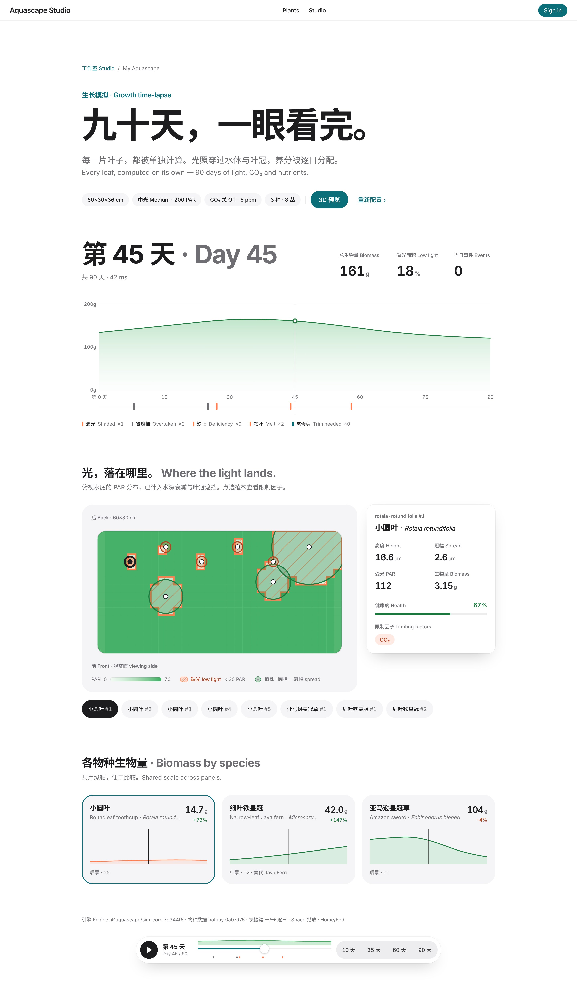

# Iteration log · 2026-11-12 (Pacific Time)

> Today = **catch-up**: redo the work of 11-11 / 11-12 (the original session had no GitHub write access and the code was lost, so it was redone today). No new feature iteration was started.

## Research
- Similar apps: the mainstream aquascaping apps (Tropica, Vivarium: Nature Design, Aquarium Planner AR) have no growth simulation; only one personal open-source project has a deterministic 0–52 week growth slider → our "watch the tank grow" is still the differentiator.
  - https://joebarbere.bearblog.dev/aquascape/
  - https://apps.apple.com/us/app/id6758380171 (Vivarium: Nature Design)
- Substrate (aquasoil) depletion time: forum claims vary from 1 to 3 years; Tropica root-fertilizer capsules are used up in about 2 months. Our model follows Xiaopu's setting of "about 120 days to 95% depleted" (only covers the 90-day timeline, on the conservative side); it can be calibrated against real measurements later.
  - https://ukaps.org/forum/threads/aqua-soil-depletion.76922
  - https://shop.glassaqua.com/products/tropica-nutrition-capsules
- Visual reference: Design canvas v3 · Ultra-white glass (no comments). Design tokens were extracted from it and written into ROADMAP.md.

## Requirements
Umbrella issue: aquascape-studio#1 — growth time-lapse. Sub-issues: aquascape-sim#2, aquascape-botany#1, aquascape-web#1.

## Contract
- `aquascape-sim/ts/src/contract.ts` v1.0.0 — https://github.com/aquascape-studio/aquascape-sim/pull/1 (merged)

## Results per agent
| agent | model | repo | result | PR |
|---|---|---|---|---|
| sim-agent | opus | aquascape-sim | `@aquascape/sim-core`: function-by-function Python port + spatial light grid + sfc32 PRNG + per-cell aquasoil nutrient pools + Worker protocol. Max parity error 4.4e-16; 90 days × 30 plants cold start ~90 ms / warm ~14 ms; with no fertilizer, aquasoil shows no iron deficiency over 90 days, inert shows iron deficiency on day 28; 32 tests pass | [sim#3](https://github.com/aquascape-studio/aquascape-sim/pull/3) ✅ merged |
| botany-agent | sonnet | aquascape-botany | plants.json 36 → **78 species** (+42, including HC Cuba, bladderwort, mini hairgrass, red-palace H'ra, snowflake grass, chili fig, trident Java fern, flame berry, antler moss, etc.), +27 BibTeX entries; I fixed 3 Chinese-name conflicts | [botany#2](https://github.com/aquascape-studio/aquascape-botany/pull/2) ✅, [botany#3](https://github.com/aquascape-studio/aquascape-botany/pull/3) (version 0.2.0, fixes publish E409) ✅ |
| app-agent | opus | aquascape-web | Vendoring of sim-core (`scripts/sync-sim-core.sh` + VENDOR.json), `growthTimelapse` flag, Worker + `useGrowthSim` + `buildInput`; new /studio/sim timeline (page unchanged when the flag is off). Typecheck / 19 tests / build pass in both flag states. I changed the light levels to 100/200/320 PAR (the original 80 PAR left the whole tank bottom light-starved) and lightened the heatmap color scale | [web#2](https://github.com/aquascape-studio/aquascape-web/pull/2) ✅ merged |

## Screenshots (flag on, day 45) — please have Xiaopu confirm the visuals
- Desktop: 
- Mobile: 

## Deployment
- aquascape-web main (df53ab0) → GitHub Actions [run 43142473976](https://github.com/aquascape-studio/aquascape-web/actions/runs/43142473976): build ✅, deploy ✅ (image pushed to ECR + ECS `aquascape-web-dev` service updated). Live URL https://efferves.live/studio/sim
- `NEXT_PUBLIC_FF_GROWTH_TIMELAPSE` is not set in the deployment → the live site is still the old page; the new timeline will be turned on after Xiaopu confirms.
- ⚠️ Live verification not completed: this session's network policy does not allow access to efferves.live (DNS resolution fails), so the page's accessibility could not be confirmed from the sandbox. The domain needs to be allowed in the environment's network settings.
- CI on main is green for aquascape-sim and aquascape-botany; botany published 0.2.0 (fixing E409).

## Directional decisions and rationale
1. **The engine runs in the browser** (TS + Web Worker), not via gRPC → aquascape-sim: dragging the timeline requires millisecond response, and it adds no Fargate cost. Python stays as the reference implementation, with parity fixtures locking the two together.
2. **web pulls in sim-core by vendoring** (instead of publishing an npm package): CI no longer needs to check out the sim repo, and the version is pinned by the commit recorded in VENDOR.json.
3. **Light levels calibrated to "tank-top PAR"**: Low/Medium/High = 100/200/320, giving about 34/68/109 PAR at the bottom of a 36 cm tank, in line with common plant lights.
4. Today was catch-up only, no new features: the catch-up itself was a full cross-repo iteration (3 agents).

## Failures / unfinished
- botany: the sandbox cannot reach tropica.com / dennerle / flowgrow directly (DNS failure); the new species' values come from vendor/retailer pages cited in search results, noted in the bib; 14 old citation keys are missing bib entries; the Python pydantic validator is out of sync with the data (an old problem, CI does not run it). Some Chinese names still need verification ("红松尾" ("red pine-tail"), "松尾" ("pine-tail"), "黄椒草" ("yellow pepper plant"), "叉柱狸藻" ("fork-column bladderwort"), "水松" ("water pine"), "巴西水芹" ("Brazilian water celery"), etc.).
- sim contract objections (v1.1 tomorrow): `parAtPlant` is the PAR when the light is on, not the daily mean; there is no `cancelled` response; the rule for turning a three-point envelope into a four-point trapezoid should be written into the contract; `deficiency` events should be deduplicated per "plant × nutrient"; the Frame has no remaining substrate nutrient.
- web: the vendored engine files got `// @ts-nocheck` (sim-core does not enable `noUncheckedIndexedAccess`); with CO₂ off, Amazon sword biomass declines after 45 days and small round leaf (Rotala rotundifolia) melts — engine behavior that needs calibration.
- e2e: the umbrella repo's smoke test still asserts the old ink-green home page, and since this sandbox cannot reach efferves.live, it was not run.

## Usage
3 sub-agents (sim: opus ~13 min; botany: sonnet ~8 min; web: opus ~20 min) + orchestrator (this session's model). Total elapsed about 1 hour.

## Suggestions for tomorrow
Issue sim-core contract v1.1 (the 5 points above), and start P2: the frontal stylized 3D tank (instanced rounded leaves + MeshPhysicalMaterial transmission), with each plant's height/coverage driven by sim frames, behind a flag.

## Addendum: Xiaopu approves the visuals
- Xiaopu replied "approve" → via [web#3](https://github.com/aquascape-studio/aquascape-web/pull/3) `NEXT_PUBLIC_FF_GROWTH_TIMELAPSE=1` is set in the deployment build, and /studio/sim switches to the new timeline live. Rollback = revert web#3.
