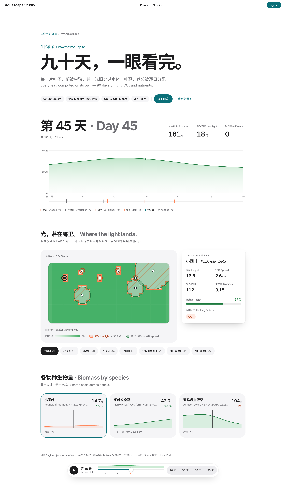

# 迭代日志 · 2026-11-12（太平洋时间）

> 本日 = **补课**：重做 11-11 / 11-12 两天的成果（原会话无 GitHub 写权限，代码丢失，于今日重做）。没有另开新功能迭代。

## 调研 (research)
- 同类 app：主流造景 app（Tropica、Vivarium: Nature Design、Aquarium Planner AR）都不做生长模拟 (growth simulation)，只有一个个人开源项目做了 0–52 周的确定性生长滑块 → 我们的"看着缸长起来"仍然是差异点。
  - https://joebarbere.bearblog.dev/aquascape/
  - https://apps.apple.com/us/app/id6758380171（Vivarium: Nature Design）
- 底床 (aquasoil) 耗尽时间：论坛说法 1–3 年不等，Tropica 根肥胶囊约 2 个月耗尽。我们的模型按 Xiaopu 的设定"约 120 天耗尽 95%"（只覆盖 90 天时间轴，偏保守），后续可按实测校准。
  - https://ukaps.org/forum/threads/aqua-soil-depletion.76922
  - https://shop.glassaqua.com/products/tropica-nutrition-capsules
- 视觉参考：Design 画布 v3 · 超白玻璃（无评论）。从中提取设计令牌 (design tokens)，已写进 ROADMAP.md。

## 需求
总 issue：aquascape-studio#1 — 生长延时 (growth time-lapse)。子 issue：aquascape-sim#2、aquascape-botany#1、aquascape-web#1。

## 契约 (contract)
- `aquascape-sim/ts/src/contract.ts` v1.0.0 — https://github.com/aquascape-studio/aquascape-sim/pull/1（已合并）

## 各 agent 结果
| agent | 模型 | 仓库 | 结果 | PR |
|---|---|---|---|---|
| sim-agent | opus | aquascape-sim | `@aquascape/sim-core`：Python 逐函数移植 + 空间光照网格 + sfc32 PRNG + aquasoil 逐格养分池 + Worker 协议。parity 最大误差 4.4e-16；90 天×30 株 冷启动 ~90 ms / 热 ~14 ms；无施肥 aquasoil 90 天不缺铁、inert 第 28 天缺铁；32 测试通过 | [sim#3](https://github.com/aquascape-studio/aquascape-sim/pull/3) ✅ 已合并 |
| botany-agent | sonnet | aquascape-botany | plants.json 36 → **78 种**（+42，含 HC Cuba、狸藻、迷你牛毛毡、红宫廷 H'ra、雪花草、辣椒榕、三叉铁皇冠、火焰莓、鹿角苔等），+27 条 BibTeX；我修正了 3 个中文名冲突 | [botany#2](https://github.com/aquascape-studio/aquascape-botany/pull/2) ✅、[botany#3](https://github.com/aquascape-studio/aquascape-botany/pull/3)（版本号 0.2.0，修复发布 E409）✅ |
| app-agent | opus | aquascape-web | vendoring sim-core（`scripts/sync-sim-core.sh` + VENDOR.json）、`growthTimelapse` 开关、Worker + `useGrowthSim` + `buildInput`；/studio/sim 新时间轴（开关关闭时页面不变）。两种开关状态 typecheck / 19 测试 / build 均通过。我把光照档位改为 100/200/320 PAR（原 80 PAR 导致整个缸底都缺光）并调浅热图色阶 | [web#2](https://github.com/aquascape-studio/aquascape-web/pull/2) ✅ 已合并 |

## 截图（开关打开，第 45 天）— 请 Xiaopu 确认视觉
- 桌面：
- 手机：

## 部署
DEPLOY_PLACEHOLDER

## 方向性决定及理由
1. **引擎跑在浏览器**（TS + Web Worker），不走 gRPC → aquascape-sim：拖时间轴要求毫秒级响应，且不增加 Fargate 成本。Python 保留为参考实现，parity fixture 锁死一致性。
2. **web 以 vendoring 方式引入 sim-core**（而不是发 npm 包）：CI 不需要再 checkout sim 仓库，版本由 VENDOR.json 记录的 commit 锁定。
3. **光照档位按"缸面 PAR"标定**：Low/Medium/High = 100/200/320，36 cm 缸底约 34/68/109 PAR，与常见水草灯一致。
4. 今天只做补课，不开新功能：补课本身是一次完整的跨仓库迭代（3 个 agent）。

## 失败 / 未完成
- botany：沙盒无法直连 tropica.com / dennerle / flowgrow（DNS 失败），新物种数值来自搜索结果引用的厂商/零售商页面，bib 里已注明；14 个旧 citation key 缺 bib 条目；Python pydantic 校验器与数据不同步（旧问题，CI 未运行）。部分中文名待核实（红松尾、松尾、黄椒草、叉柱狸藻、水松、巴西水芹等）。
- sim 契约异议（明天出 v1.1）：`parAtPlant` 是开灯时 PAR 而非日均；缺少 `cancelled` 响应；三点包络转四点梯形的规则应写进契约；`deficiency` 事件应按"植株×养分"去重；Frame 里没有底床养分余量。
- web：vendored 引擎文件加了 `// @ts-nocheck`（sim-core 未开 `noUncheckedIndexedAccess`）；CO₂ 关闭时亚马逊皇冠 45 天后生物量下降、小圆叶融叶——引擎行为，需要校准。
- e2e：总仓 smoke 测试仍断言旧的 ink-green 首页，且本沙盒无法访问 efferves.live，未运行。

## 用量
3 个子 agent（sim: opus ~13 min；botany: sonnet ~8 min；web: opus ~20 min）+ orchestrator（本会话模型）。总耗时约 1 小时。

## 明天的建议
出 sim-core 契约 v1.1（上面 5 条），并开始 P2：正面视角风格化 3D 水缸（instancing 圆润叶片 + MeshPhysicalMaterial transmission），由 sim 帧驱动每株高度/覆盖率，放在开关后面。
