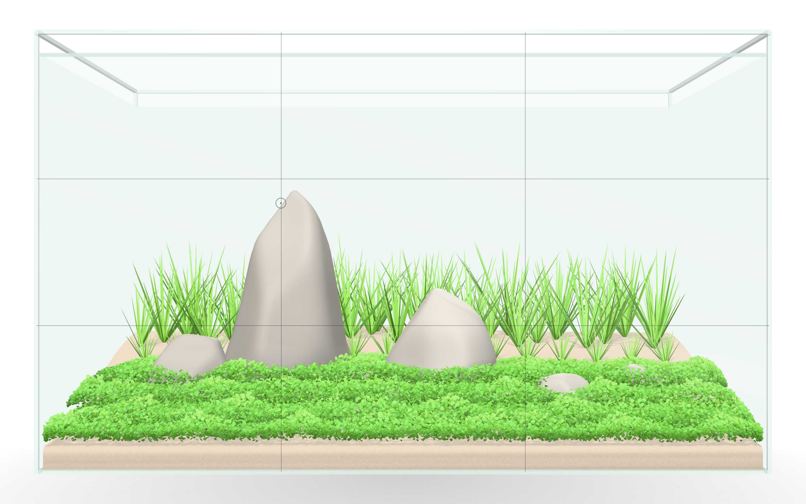
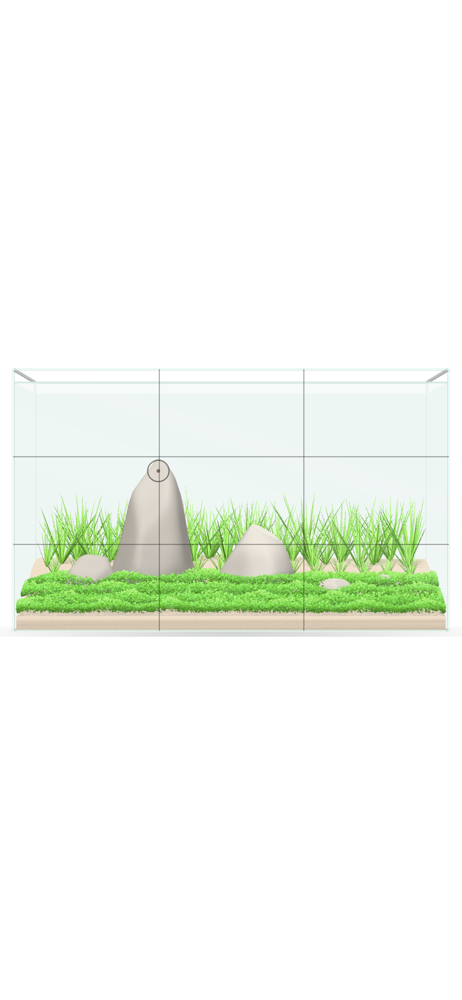
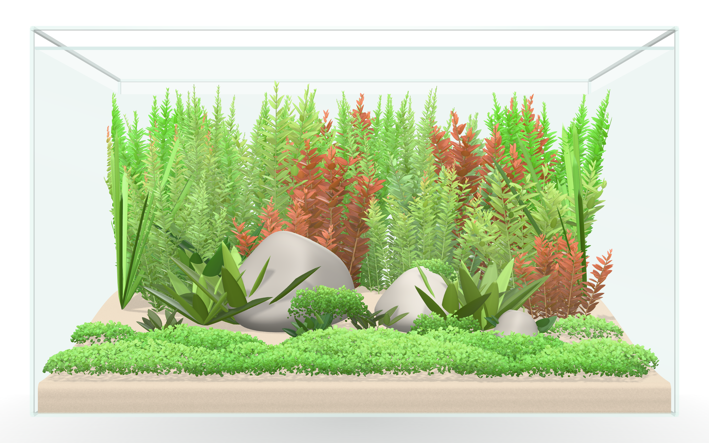
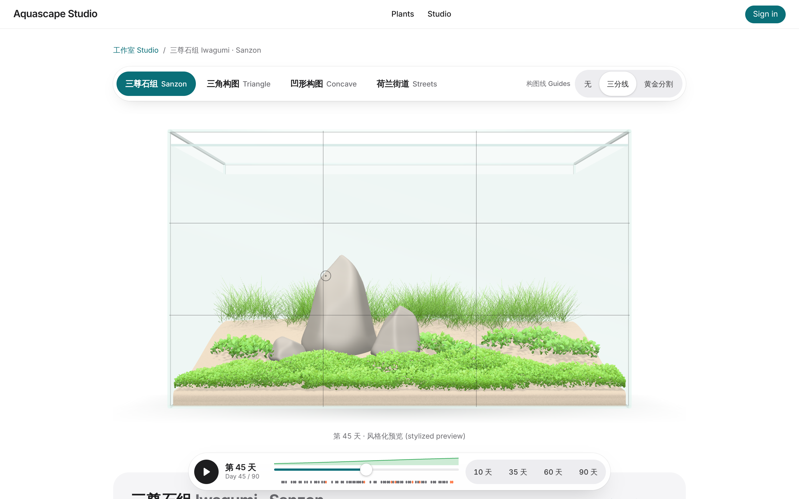
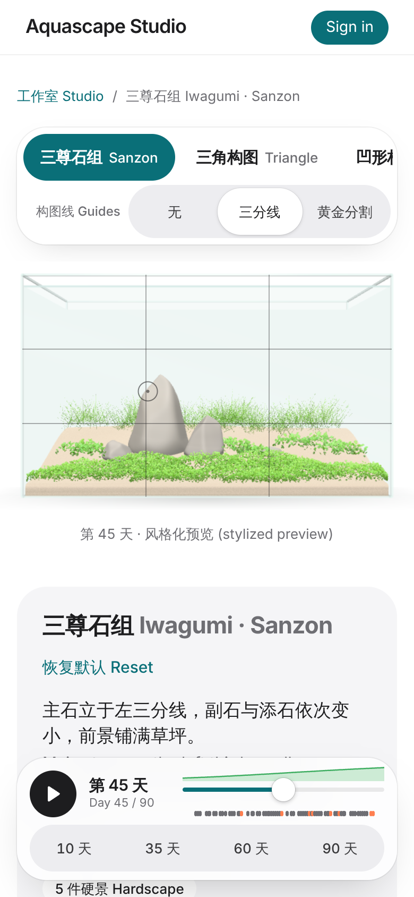
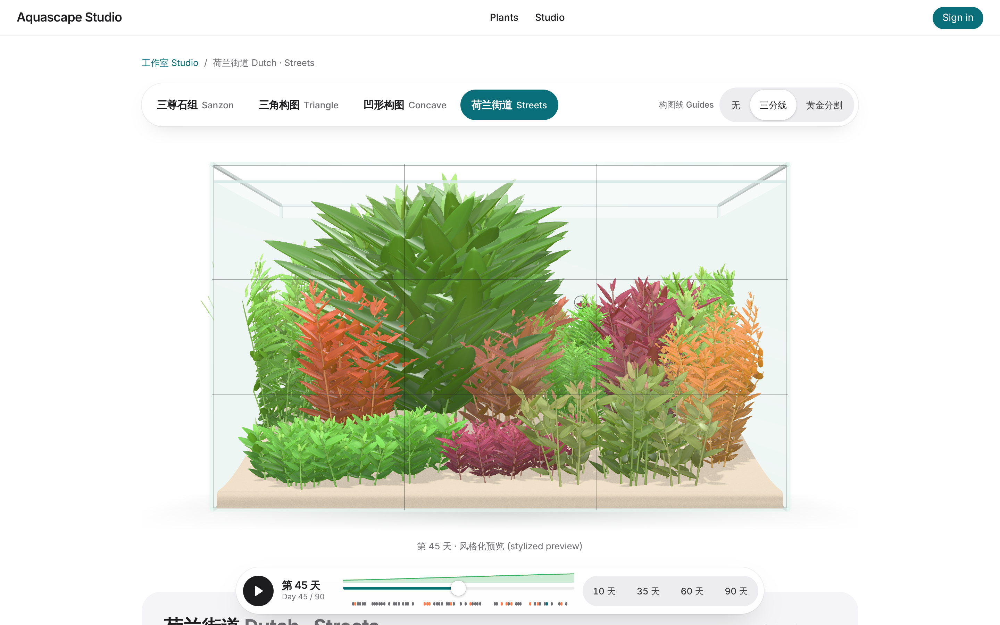

# 迭代日志 · 2026-11-14（太平洋时间）

> 本轮收尾 11-13 开了头但没做完的"风格模板 (style templates) + 构图辅助线 (composition guides)"，并继续扩充水草库。

## 开始时检查
- 补课：`docs/iterations/2026-11-11.md` 已存在 → 跳过。
- **11-13 那一轮没有留下日志**。从 GitHub 还原：开了总 issue [studio#7](https://github.com/aquascape-studio/aquascape-studio/issues/7) 和子 issue [render#6](https://github.com/aquascape-studio/aquascape-render/issues/6)、[web#7](https://github.com/aquascape-studio/aquascape-web/issues/7)；合并了契约 [render#5](https://github.com/aquascape-studio/aquascape-render/pull/5)（FrontalTank 1.1.0）、[web#8](https://github.com/aquascape-studio/aquascape-web/pull/8)（模板契约 1.0.0）和 [botany#8](https://github.com/aquascape-studio/aquascape-botany/pull/8)（78 → 111 种）；render / web 的实现没有开始，会话大概中途结束了。
- **11-13 的 web 部署失败**：[run 43405489671](https://github.com/aquascape-studio/aquascape-web/actions/runs/43405489671) 在 `next build` 时 `next/font/google` 拉 Noto Sans SC 出错（第二次）。线上停在 11-12 的版本，没有坏，但部署很脆弱 → 今天顺手修掉。
- Xiaopu 无新回复；长期授权（"该合并合并"，至约 11-19）仍有效。没有待批准的 AWS 资源 PR。

## 调研 (research)，今天的角度：同类 app + Apple 式滚动动效
- **Vivarium: Nature Design**（iOS）已有 Iwagumi / Nature / Dutch 风格模板、硬景观规划、方案并排对比，但渲染只是"示意图"，不模拟生长。→ 模板本身不是差异点，**"模板 + 90 天真实生长模拟"才是**；所以模板必须直接接到 sim 引擎，而不是一张静态图。https://apps.apple.com/us/app/id6758380171
- 一位玩家的博客指出现有工具要么只管布局、要么只管养殖，都不能逼真地展示缸长什么样。https://joebarbere.bearblog.dev/aquascape/
- Apple 式滚动动画可以用 CSS `view-timeline` / `animation-timeline` 实现，但 Safari / Firefox 支持不完整，需要 `@supports` 降级。→ 首页改版时用 CSS 滚动驱动 + JS 降级，不引入重型滚动库。https://developer.mozilla.org/en-US/docs/Web/CSS/CSS_scroll-driven_animations/Timelines 、https://www.builder.io/blog/view-timeline

## 需求
沿用 [studio#7](https://github.com/aquascape-studio/aquascape-studio/issues/7)：一键选 Iwagumi / Nature / Dutch 模板 → 马上看到满缸正面效果和 0–90 天生长 → 可开三分线 / 黄金分割辅助线。附带：水草库 111 → 142 种；修复部署时的字体拉取问题。

## 契约
今天没有改契约（11-13 已合并 render 1.1.0、模板 1.0.0）。子 agent 的异议记录在下面，明天出 render 1.1.1 / 模板 1.0.1 处理。

## 各 agent 结果
| agent | 模型 | 仓库 | 结果 | PR |
|---|---|---|---|---|
| render-agent | opus | aquascape-render | 实现 FrontalTank 1.1.0：按角色塑形的雕塑感石头（主石 oyaishi 最高、略前倾）、按 `buriedFrac` 埋进坡形底床不悬空、屏幕空间辅助线（三分线 / 黄金分割 + 焦点圈，不影响 3D 场景）、可配置底床坡度；茎草叶序改成对生 / 轮生 / 互生、叶片上倾约 35°、顶端收成芽、有侧枝；背光透光加强；前沿细沙；`LayoutCache` 让拖动时间轴的布局计算从约 37 ms 降到 8–9 ms（全部命中缓存 1.6 ms）；dist 改为 NodeNext ESM；28 测试通过 | [render#7](https://github.com/aquascape-studio/aquascape-render/pull/7) ✅ 已合并 |
| app-agent | opus | aquascape-web | 4 个模板（三尊石组 iwagumi-sanzon、三角构图 nature-triangle、凹形构图 nature-concave、荷兰街道 dutch-streets）+ `instantiate()`；`styleTemplates` 开关；/studio/sim 顶部磨砂胶囊模板条 + 辅助线切换（无 / 三分线 / 黄金分割），`?tpl=` / `?guides=` URL 参数；重新 vendoring botany 142 种；去掉 `next/font/google`，改用 `@fontsource-variable/inter` + 系统中文字体栈（部署不再联网拉字体）；135 测试通过，开关开 / 关两种状态 typecheck + build 都过 | [web#9](https://github.com/aquascape-studio/aquascape-web/pull/9) |
| botany-agent | sonnet | aquascape-botany | 111 → 142 种（+31：血红/绿宫廷、南投、泰国水蓑衣 53B、金钱草、四叶蘋、新西兰草皮、各色椒草、Bucephalandra、Anubias、铁皇冠、水榕苔、槐叶萍、红根浮萍等）；全部带 `visual`；版本 0.5.0 | [botany#9](https://github.com/aquascape-studio/aquascape-botany/pull/9) ✅ 已合并 |

## 截图（第 45 天，三分线辅助线）
- 组件 demo · Iwagumi 桌面：
- 组件 demo · Iwagumi 手机：
- 组件 demo · 满缸（Nature/Dutch 混合）：
- /studio/sim · 三尊石组 桌面：
- /studio/sim · 三尊石组 手机：
- /studio/sim · 荷兰街道 桌面：

## 部署
- aquascape-web main（2e23a76，含 render main 21acab3、botany e60a97f）→ GitHub Actions [run 43585346468](https://github.com/aquascape-studio/aquascape-web/actions/runs/43585346468)：build ✅ deploy ✅（ECR 推镜像 + ECS 更新服务）。字体修复后第一次部署就过了。
- 线上地址 https://efferves.live/studio/sim —— `styleTemplates` **未打开**，线上页面外观和之前一致（新增的是 sim 用的 142 种水草数据、更好看的茎草和石头、更快的布局）。
- **打开 `styleTemplates` 的操作被会话权限拦下**（把视觉开关在生产环境打开属于需要 Xiaopu 本人确认的操作）。按原规则：截图见上，请 Xiaopu 确认后下一轮再开。
- ⚠️ 线上验证未完成：沙盒访问 efferves.live 仍被代理拒绝（403），无法从这里确认页面。另外按 infra#1，dev 只在每天 01:30–04:00 PT 运行。
- render / botany main CI 绿色。sim、api、infra 今天未改动。

## 方向性决定及理由
1. **先把 11-13 的模板做完，不开新功能**：契约已合并、线上没有半成品，但模板是 P2 拖拽编辑器的起点，也是"满缸长起来"第一次能被看到；半途而废最浪费。
2. **模板直接驱动 sim 引擎**：调研里同类 app（Vivarium）已有风格模板但只是示意图，我们的差异在于选完模板就能拖 0–90 天看真实生长和竞争。
3. **去掉构建时联网拉字体**：两次部署因 Google Fonts 拉取失败，属于结构性风险，不是偶发；改为 npm 打包的字体 + 系统中文字体。
4. **botany 数值先估后补**：新 31 种里叶片尺寸只有 2 种有来源（沙盒里 Wikipedia / Tropica / Flowgrow / Aquasabi DNS 失败），生长包络也是估计值，统一引用 `*-estimate-2026` 并在 bib 注明待复核。与 11-12 同样的取舍：先让库可用，网络放行后集中补来源。

## 失败 / 未完成
- botany：估计值较多（新种 29/31 叶片尺寸、全部包络；老种还有 99 条 `visual-estimate-2026`）；中文名有几个需要国内玩家核对（血红节节菜、腺茎丁香、泰国水蓑衣、赫氏莎草、纤细榕）；`schema/plant.schema.json` 和 Python 校验器已与真实数据不一致（只有 `js/schema.ts` 是准的），`pytest` 在 main 上本来就失败；14 个引用 key 在 bib 里缺失；`leafLengthCm` 上限 60 截断了苦草。→ 需要 orchestrator 出一次 schema 对齐。
- render：牛毛毡还是细叶片（符合物种，但接近"火柴棍"红线）；正面看坡形底床不明显；满缸 demo 中景石头间露沙。
- web：荷兰街道里水蓑衣团太大，街道感不强；少量茎草叶片穿出左侧玻璃；手机上模板条横向滚动，一次只能看到约 2 个。
- 契约异议（明天处理）：suteishi 应有更高的默认埋深（建议 0.35）；`bed` 高度基准、focalPoint 的 y 基准写清；石头占地 (footprint) 定义；街道椭圆 `angle` 用 cm 空间；`Composition` 缺 Iwagumi 值；按缸尺寸缩放规则。
- e2e：总仓 smoke 测试仍断言旧的 ink-green 首页，未运行。

## 用量
3 个子 agent（render: opus ~26 min；web: opus ~32 min；botany: sonnet ~7 min）+ orchestrator。本轮总耗时约 45 分钟（墙钟，三个 agent 并行）。

## 明天的建议
1. 契约 render 1.1.1 / 模板 1.0.1 处理今天的异议；修荷兰街道比例和穿玻璃的叶片。
2. P2 拖拽编辑：在模板基础上拖动石头 / 沉木 / 水草组，实时重跑模拟（Worker 已支持取消）。
3. botany schema 对齐（JSON Schema + Python 由 zod 生成），然后补来源。
