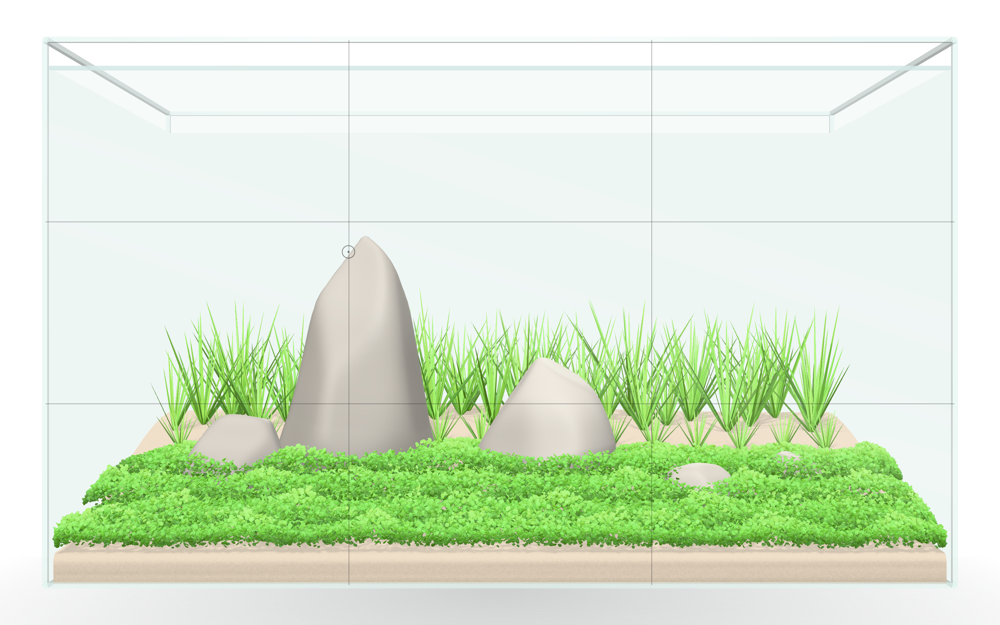
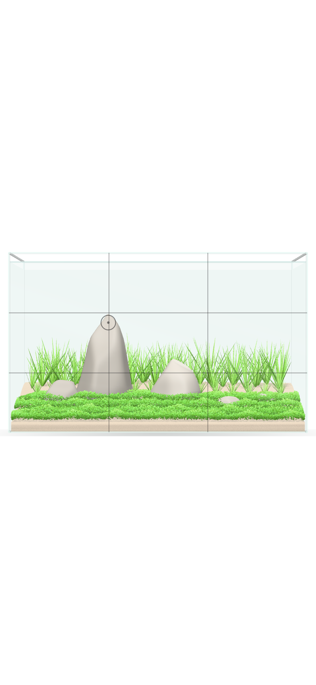
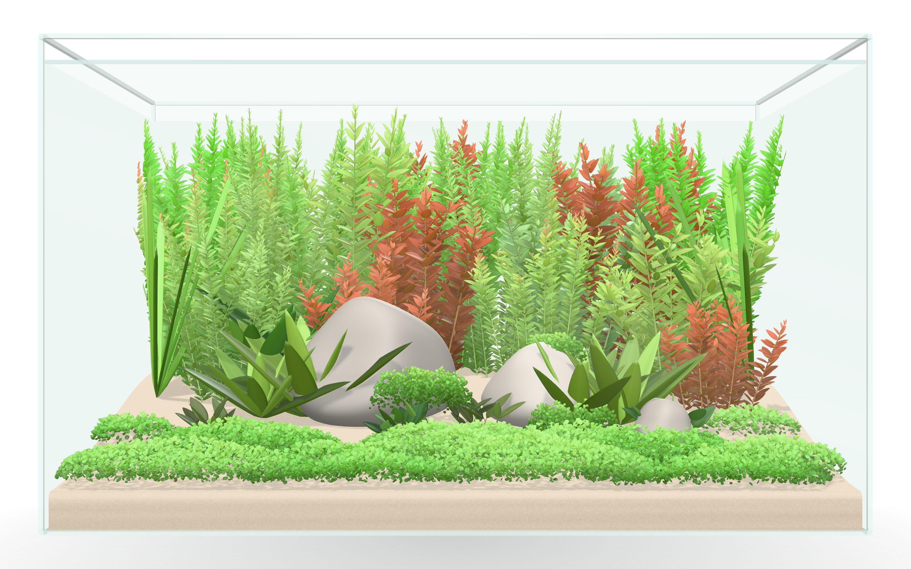
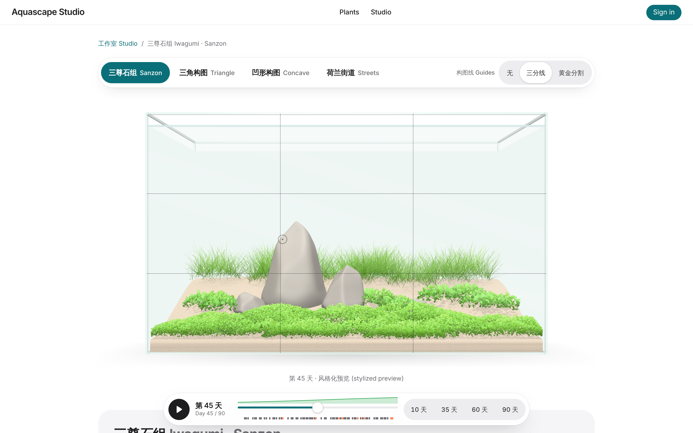
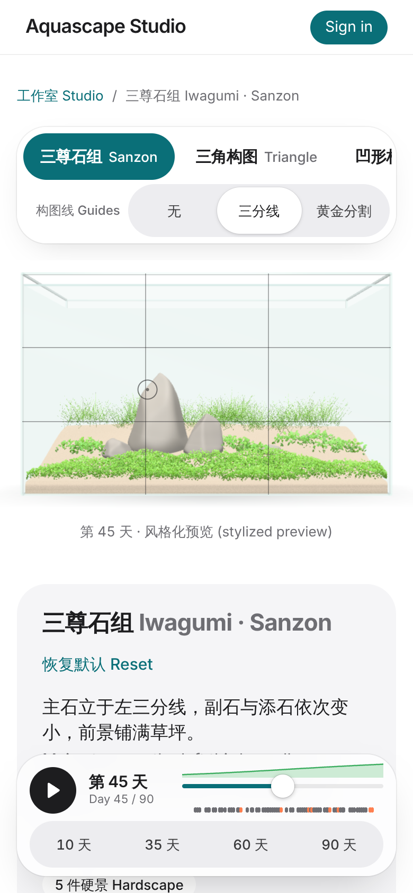
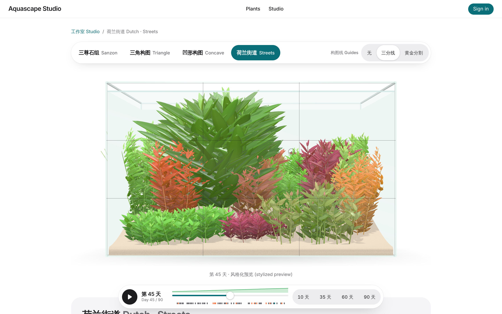

# Iteration log · 2026-11-14 (Pacific Time)

> This round finishes the "style templates + composition guides" that 11-13 started but did not complete, and continues expanding the plant library.

## Checks at start
- Catch-up: `docs/iterations/2026-11-11.md` already exists → skipped.
- **The 11-13 round left no log.** Reconstructed from GitHub: it opened the umbrella issue [studio#7](https://github.com/aquascape-studio/aquascape-studio/issues/7) and sub-issues [render#6](https://github.com/aquascape-studio/aquascape-render/issues/6), [web#7](https://github.com/aquascape-studio/aquascape-web/issues/7); merged the contracts [render#5](https://github.com/aquascape-studio/aquascape-render/pull/5) (FrontalTank 1.1.0), [web#8](https://github.com/aquascape-studio/aquascape-web/pull/8) (template contract 1.0.0) and [botany#8](https://github.com/aquascape-studio/aquascape-botany/pull/8) (78 → 111 species); the render / web implementations were not started, and the session probably ended midway.
- **The 11-13 web deployment failed**: [run 43405489671](https://github.com/aquascape-studio/aquascape-web/actions/runs/43405489671) errored during `next build` when `next/font/google` fetched Noto Sans SC (the second time). The live site stayed on the 11-12 version and is not broken, but deployment is fragile → fixed in passing today.
- No new reply from Xiaopu; the standing authorization ("merge whatever should be merged", until about 11-19) is still in effect. No AWS resource PRs awaiting approval.

## Research, today's angle: similar apps + Apple-style scroll motion
- **Vivarium: Nature Design** (iOS) already has Iwagumi / Nature / Dutch style templates, hardscape planning, and side-by-side plan comparison, but its rendering is only a "mockup" and does not simulate growth. → Templates themselves are not the differentiator; **"templates + a real 90-day growth simulation" is**, so templates must connect directly to the sim engine rather than being a static picture. https://apps.apple.com/us/app/id6758380171
- A player's blog points out that existing tools either handle only layout or only cultivation, and none can realistically show what the tank will look like. https://joebarbere.bearblog.dev/aquascape/
- Apple-style scroll animation can be built with CSS `view-timeline` / `animation-timeline`, but Safari / Firefox support is incomplete and needs an `@supports` fallback. → For the home page redesign, use CSS scroll-driven animation + a JS fallback, without bringing in a heavy scroll library. https://developer.mozilla.org/en-US/docs/Web/CSS/CSS_scroll-driven_animations/Timelines , https://www.builder.io/blog/view-timeline

## Requirements
Continues [studio#7](https://github.com/aquascape-studio/aquascape-studio/issues/7): one-click choice of an Iwagumi / Nature / Dutch template → immediately see the full frontal tank and 0–90 day growth → rule-of-thirds / golden-ratio guides can be turned on. Also: plant library 111 → 142 species; fix the font-fetching problem at deploy time.

## Contracts
No contracts changed today (render 1.1.0 and template 1.0.0 were merged on 11-13). The sub-agents' objections are recorded below, to be handled tomorrow in render 1.1.1 / template 1.0.1.

## Results per agent
| agent | model | repo | result | PR |
|---|---|---|---|---|
| render-agent | opus | aquascape-render | Implemented FrontalTank 1.1.0: sculptural rocks shaped by role (main stone oyaishi tallest, leaning slightly forward), embedded into the sloped substrate bed by `buriedFrac` so they do not float, screen-space guides (rule of thirds / golden ratio + focal circle, not affecting the 3D scene), configurable substrate slope; stem-plant leaf arrangement changed to opposite / whorled / alternate, leaves tilted up about 35°, tips closing into buds, with side branches; stronger back-light translucency; fine sand at the front edge; `LayoutCache` cuts layout computation while dragging the timeline from about 37 ms to 8–9 ms (1.6 ms when everything hits the cache); dist changed to NodeNext ESM; 28 tests pass | [render#7](https://github.com/aquascape-studio/aquascape-render/pull/7) ✅ merged |
| app-agent | opus | aquascape-web | 4 templates (Iwagumi sanzon iwagumi-sanzon, triangle composition nature-triangle, concave composition nature-concave, Dutch streets dutch-streets) + `instantiate()`; `styleTemplates` flag; frosted pill template bar + guide toggle (none / rule of thirds / golden ratio) at the top of /studio/sim, with `?tpl=` / `?guides=` URL parameters; re-vendored botany 142 species; removed `next/font/google` in favor of `@fontsource-variable/inter` + a system Chinese font stack (deploys no longer fetch fonts over the network); 135 tests pass, typecheck + build pass with the flag both on and off | [web#9](https://github.com/aquascape-studio/aquascape-web/pull/9) |
| botany-agent | sonnet | aquascape-botany | 111 → 142 species (+31: blood-red / green palace plants, Nantou, Thai water willow 53B, moneywort, four-leaf clover fern, New Zealand turf, various Cryptocoryne, Bucephalandra, Anubias, Java fern, willow moss, floating fern, red-root floater, etc.); all with `visual`; version 0.5.0 | [botany#9](https://github.com/aquascape-studio/aquascape-botany/pull/9) ✅ merged |

## Screenshots (day 45, rule-of-thirds guides)
- Component demo · Iwagumi desktop: 
- Component demo · Iwagumi mobile: 
- Component demo · full tank (Nature/Dutch mix): 
- /studio/sim · Iwagumi sanzon desktop: 
- /studio/sim · Iwagumi sanzon mobile: 
- /studio/sim · Dutch streets desktop: 

## Deployment
- aquascape-web main (2e23a76, including render main 21acab3, botany e60a97f) → GitHub Actions [run 43585346468](https://github.com/aquascape-studio/aquascape-web/actions/runs/43585346468): build ✅ deploy ✅ (image pushed to ECR + ECS service updated). The first deploy after the font fix passed.
- Live URL https://efferves.live/studio/sim — `styleTemplates` is **not turned on**, so the live page looks the same as before (what was added is the 142-species plant data used by sim, nicer stem plants and rocks, and faster layout).
- **The session's permissions blocked the action of turning on `styleTemplates`** (turning a visual flag on in production is an action that requires Xiaopu's own confirmation). Per the original rule: see the screenshots above, and ask Xiaopu to confirm before turning it on in the next round.
- ⚠️ Live verification not completed: the sandbox's access to efferves.live is still rejected by the proxy (403), so the page cannot be confirmed from here. Also, per infra#1, dev only runs 01:30–04:00 PT daily.
- render / botany main CI is green. sim, api, infra were not changed today.

## Directional decisions and rationale
1. **Finish 11-13's templates first, no new features**: the contracts are merged and there is no half-finished work live, but templates are the starting point for the P2 drag editor and the first time a "full tank growing" can be seen; abandoning them midway would waste the most.
2. **Templates drive the sim engine directly**: in the research, a similar app (Vivarium) has style templates but only as mockups; our difference is that after choosing a template you can drag through 0–90 days and see real growth and competition.
3. **Remove build-time font fetching over the network**: two deploys failed because of Google Fonts fetching, which is a structural risk, not an occasional glitch; switched to npm-bundled fonts + system Chinese fonts.
4. **botany values are estimated first, sourced later**: of the 31 new species only 2 have sourced leaf dimensions (Wikipedia / Tropica / Flowgrow / Aquasabi fail DNS in the sandbox), and the growth envelopes are also estimates, all citing `*-estimate-2026` with a note in the bib that they await review. The same trade-off as 11-12: make the library usable first, and add sources in one batch once the network is opened up.

## Failures / unfinished
- botany: many estimated values (29/31 of the new species' leaf dimensions, all envelopes; the older species still have 99 `visual-estimate-2026` entries); several Chinese names need checking by players in China ("blood-red Rotala", "gland-stem ludwigia", "Thai water willow", "Hess's sedge", "slender fig"); `schema/plant.schema.json` and the Python validator no longer match the real data (only `js/schema.ts` is accurate), and `pytest` was already failing on main; 14 citation keys are missing in the bib; the `leafLengthCm` upper bound of 60 truncates Vallisneria. → The orchestrator needs to do a schema alignment.
- render: hairgrass is still thin blades (true to the species, but close to the "matchstick" red line); the sloped substrate bed is not obvious from the front; in the full-tank demo sand shows between the midground rocks.
- web: in Dutch streets the water willow clumps are too large and the street feel is weak; a few stem-plant leaves poke through the left glass; on mobile the template bar scrolls horizontally, showing only about 2 at a time.
- Contract objections (to handle tomorrow): suteishi should have a higher default burial depth (suggest 0.35); state clearly the `bed` height baseline and the y baseline of focalPoint; rock footprint definition; the street ellipse `angle` should use cm space; `Composition` lacks an Iwagumi value; the rule for scaling by tank size.
- e2e: the umbrella repo's smoke test still asserts the old ink-green home page and was not run.

## Usage
3 sub-agents (render: opus ~26 min; web: opus ~32 min; botany: sonnet ~7 min) + orchestrator. Total elapsed this round about 45 minutes (wall clock, the three agents ran in parallel).

## Suggestions for tomorrow
1. Contracts render 1.1.1 / template 1.0.1 to handle today's objections; fix the Dutch streets proportions and the leaves poking through the glass.
2. P2 drag editing: on top of the templates, drag rocks / driftwood / plant groups and re-run the simulation in real time (the Worker already supports cancellation).
3. botany schema alignment (JSON Schema + Python generated from zod), then add sources.
