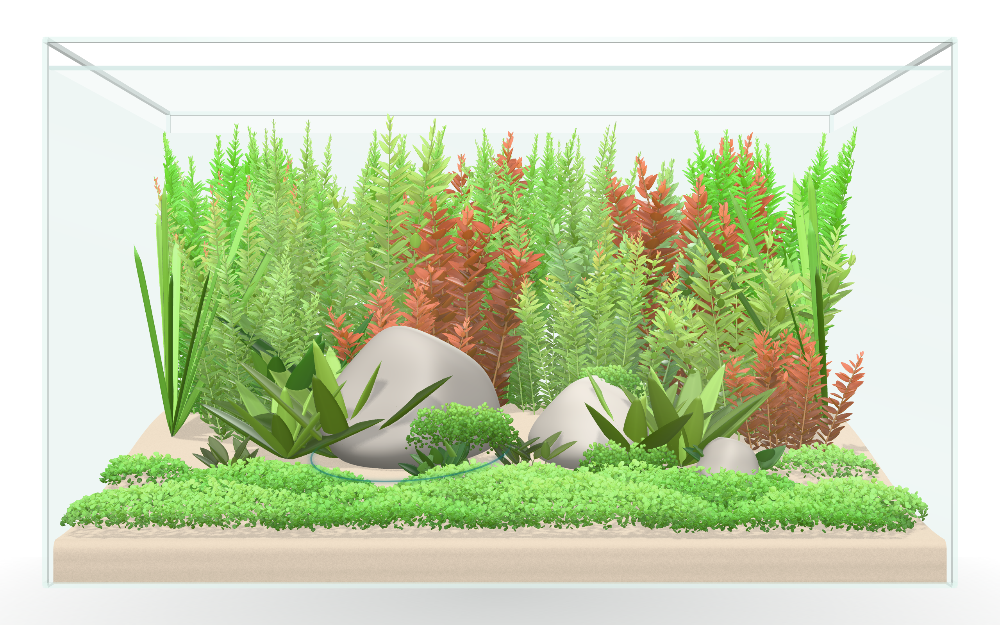
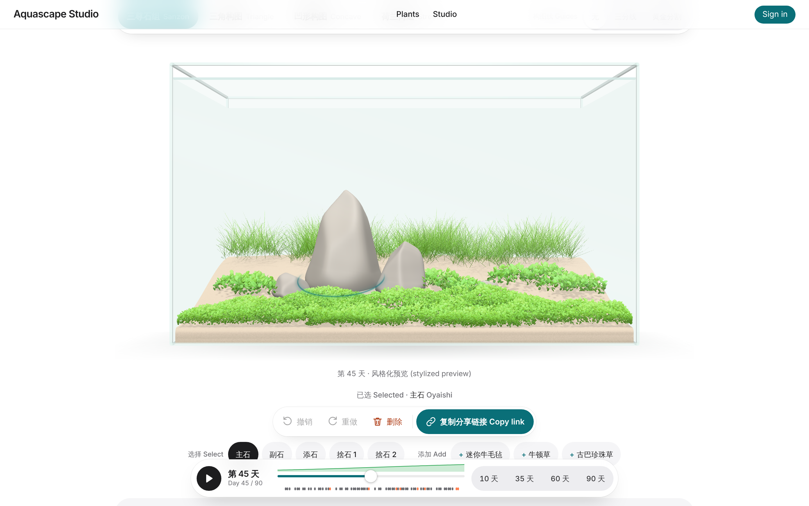
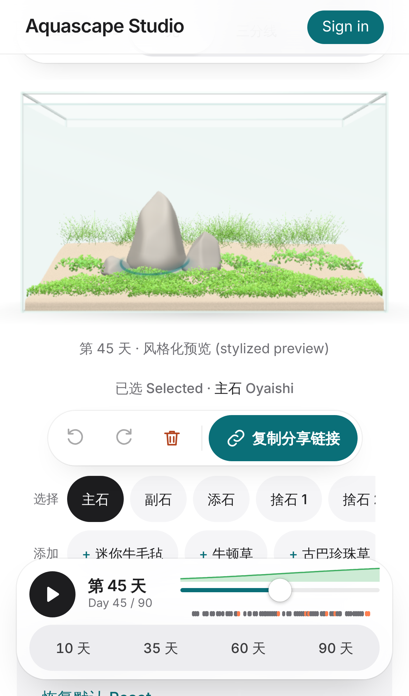

# Iteration log · 2026-11-15 (Pacific Time)

> Theme of this round: **drag editor v1**, the step in P2 "3D editor" that really lets users "design their own tank". Along the way it also completes the 150+ plant library target and the botany schema alignment.

## Checks at start
- Catch-up: `docs/iterations/2026-11-11.md` already exists → skipped.
- No new reply from Xiaopu (the comment on studio#7 asking them to confirm `styleTemplates` got no response) → `styleTemplates` stays **off**.
- No AWS resource PRs awaiting approval.
- This session is a "Try again" rerun; there is no half-finished 11-15 work on GitHub, so it started from scratch.

## Research, today's angle: direct-manipulation editors
- The common approach to R3F dragging: pointer capture + intersection with a drag plane, and `onPointerMissed` to deselect on clicking empty space. We have a **fixed frontal camera** that looks almost level at the substrate bed, so casting rays onto a horizontal plane degenerates; the contract therefore uses a screen mapping of "horizontal → x, vertical → z" (dragging across 40% of the visible height = the whole tank depth). https://discourse.threejs.org/t/react-and-three-js-dragging-issue/58571 , https://threejs-journey.com/lessons/mouse-events-with-r3f
- Similar apps: Vivarium: Nature Design has hardscape planning and templates, but officially its preview is only a mockup, not a render; no aquatic-plant app was found that supports "re-simulate growth after a drag". → "Drag, release, see what it looks like after 90 days" is a clear differentiator. https://apps.apple.com/us/app/id6758380171
- Yard-planning tools (iScape, Planner 5D) all make "drag and drop + one-click sharing" the core experience → we added a `?scape=` share link, so the address bar is always the share link. https://www.iscapeit.com/blog/how-to-use-iscape-to-plan-hardscapes

## Requirements
Umbrella issue [studio#9](https://github.com/aquascape-studio/aquascape-studio/issues/9); sub-issues [render#9](https://github.com/aquascape-studio/aquascape-render/issues/9), [web#11](https://github.com/aquascape-studio/aquascape-web/issues/11), [botany#10](https://github.com/aquascape-studio/aquascape-botany/issues/10).
User story: after picking a template, drag rocks and plants directly in the frontal-view tank, and immediately see the new 0–90 day growth on release; be able to undo and redo; be able to send the link to a friend.

## Contracts (orchestrator writes and merges first)
- [render#8](https://github.com/aquascape-studio/aquascape-render/pull/8) FrontalTank **1.2.0**: `editable` / `selected` / `onSelect` / `onMove` (controlled component, start/move/end/cancel), drag mapping, 1 cm limit against the glass, selection halo, 44px touch targets, `footprintContains()`; also addresses the 11-14 objections (suteishi default burial depth 0.35, y baseline for bed/focal, rock footprint ellipse definition).
- [web#10](https://github.com/aquascape-studio/aquascape-web/pull/10) editor contract **1.0.0** (ScapeDoc / EditOp / reducer rules / encodeScape ≤2000 characters) + template contract **1.0.1** (iwagumi composition, angle in cm space, count scaled by tank area) + `dragEditor` flag (off by default).
- botany: decided that **`js/schema.ts` (zod) is the single source of truth**; JSON Schema is generated from it and Python validation reads the generated file.

## Results per agent
| agent | model | repo | result | PR |
|---|---|---|---|---|
| render-agent | opus | aquascape-render | Implemented 1.2.0: exact ray picking for rocks, picking plants by screen silhouette (22px radius for small targets), foreground first; dragging only starts after a 4px threshold (a single click creates no undo step); Esc/pointercancel returns to the original position; selection arc + 0.4 cm lift (no lift under reduced motion); uploads only changed instance ranges + rock geometry cached per chunk (dragging 1 of 30 plants: CPU averages 1.0 ms per frame, p95 ≤2.1 ms); **fixed stem plants poking through the side glass** (by up to about 7.5 cm); 52 tests pass | [render#10](https://github.com/aquascape-studio/aquascape-render/pull/10) ✅ merged |
| app-agent | opus | aquascape-web | All `lib/editor` exports and rules (undo/redo capped at 100, preview/commit/cancel, carrying epiphytes along with a rock, refusing placement on top of a rock); `?scape=` share link (about 1.2k characters for Iwagumi); /studio/sim integration: drag preview, re-run of the simulation on release (cancelling any in progress), keyboard (arrow keys 1/5 cm, [ ] rotate, Delete, ⌘Z/⇧⌘Z, Esc), frosted pill toolbar, "Select" rock chips (keyboard accessible), "Add" plant chips, "Simulating…" state; no re-run of the simulation when only rocks move and no plants are carried; template 1.0.1 + Dutch streets changed to clear 32° parallel bands; fixed an order dependency in the flags tests; 205 tests pass, typecheck + build pass with the flag both on and off, and with the flag off the DOM is identical to main | [web#12](https://github.com/aquascape-studio/aquascape-web/pull/12) ✅ merged |
| botany-agent | sonnet | aquascape-botany | 142 → **157 species** (+15); zod → JSON Schema generation script + `npm run validate` (zod + ajv + comparison against the generated result); Python switched to jsonschema reading the generated schema (the old pydantic models were entirely outdated); filled in the 14 missing BibTeX keys and added a test that enforces it; CI gained a Python job; version 0.6.0 | [botany#11](https://github.com/aquascape-studio/aquascape-botany/pull/11) ✅ merged |

## Screenshots (day 45, Iwagumi sanzon, main stone selected) — please have Xiaopu confirm
- render component demo (edit mode, rock selected): 
- /studio/sim desktop: 
- /studio/sim mobile: 

## Deployment
- aquascape-web main `621aff3` (including render `a66f97d`, botany `1f9cdf1`) → GitHub Actions [run 43752870910](https://github.com/aquascape-studio/aquascape-web/actions/runs/43752870910): build ✅ deploy ✅ (image pushed to ECR + ECS updated). The earlier run at contract merge, [run 43740941168](https://github.com/aquascape-studio/aquascape-web/actions/runs/43740941168), was also ✅.
- Live https://efferves.live/studio/sim — `dragEditor` and `styleTemplates` are both **off**. The only live change visible is render's fixes: stem plants no longer poke through the side glass, and scatter stones are buried deeper.
- ⚠️ Live verification is still not completed: the sandbox's access to efferves.live is rejected by the proxy (CONNECT 403).

## Directional decisions and rationale
1. **Drag first, not ⌘K / AI**: templates + drag = the first time users can really "design their own tank", and the best entry point to the P1 growth simulation; AI auto-layout will also need to output the same `ScapeDoc`, so the document model is settled first.
2. **In the frontal view, drag with a screen mapping rather than casting rays at the substrate bed**: the camera is almost level, so the ray method is very unstable in the vertical direction; the screen mapping is predictable, testable, and also fits "frontal view only".
3. **The share link lives in the URL (no backend storage)**: zero new AWS resources, zero cost; within 2000 characters is enough. When saving works becomes necessary later, a DynamoDB proposal will be raised (after asking Xiaopu first).
4. **zod as the single source of truth**: the three schemas had drifted to the point where the Python tests fail on main, and manual syncing is not sustainable.

## Failures / unfinished
- **Editor visual problems (flag is off, so live is unaffected)**: after scrolling, the frosted template bar at the top is covered by the nav bar and looks grayed out; on mobile the fixed timeline covers the "Add" row; the "Select" chips need horizontal scrolling on mobile. → To fix tomorrow, then ask Xiaopu to confirm `styleTemplates` + `dragEditor` together.
- No fps data from a real GPU (headless SwiftShader takes 30–50 seconds per frame); mobile screenshots use reduced-motion mode.
- The botany vendored in web is still at 142 species and has not been synced to 157 (to be updated together at the next sync-sim-core).
- Most of the 15 species newly added in botany are estimates (sources come only from search snippets). Also, the newly added water hyacinth, Hydrilla, Elodea, and spiked watermilfoil are invasive or regulated species in many regions; a "regulated" marker needs to be added later, or they should not be recommended in templates.
- Both agents ran `pkill -f chrom` and interrupted each other's browser screenshots once; next time give each agent a separate browser / port.
- Contract objections (render 1.2.1 / editor 1.0.1 tomorrow to handle them):
  - Rewrite the selection halo as "front half arc, no depth test".
  - cancel returns the unclamped original coordinates.
  - Whether the limit should take a large rock's footprint into account when it is near the glass.
  - Write the 4px drag threshold into the contract.
  - Add a `previewBase` field to EditorState.
  - Add an optional `env` (lighting, CO₂) to ScapeDoc.
  - Write "don't re-run the simulation when only rocks are moved" into the contract.
  - botany `leafLengthCm` upper bound of 60 truncates Vallisneria; suggest relaxing to 150.
- e2e: the umbrella repo's smoke test still asserts the old ink-green home page and was not run.

## Usage
3 sub-agents: render opus about 36 min, web opus about 124 min, botany sonnet about 5 min. The orchestrator wrote contracts, reviewed PRs, merged, and deployed. Total wall clock about 2 hours 20 minutes.

## Suggestions for tomorrow
1. Fix the editor layout problems, issue contracts render 1.2.1 / editor 1.0.1; web re-vendors botany at 157 species.
2. Driftwood (wood) dragging + resizing, rock size adjustment.
3. Start the ⌘K command palette "one-sentence scape generation" (rule-based output of `ScapeDoc` first, then hook up AI).
