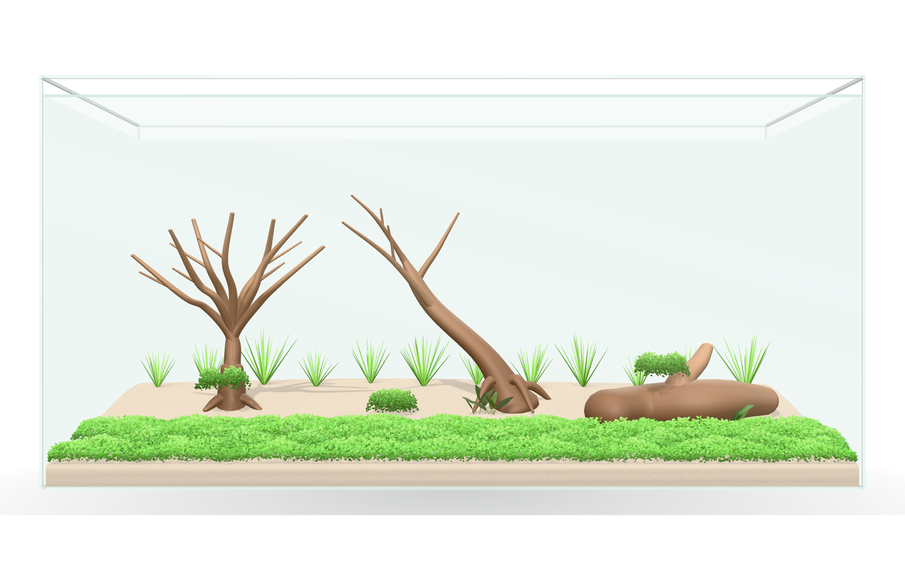
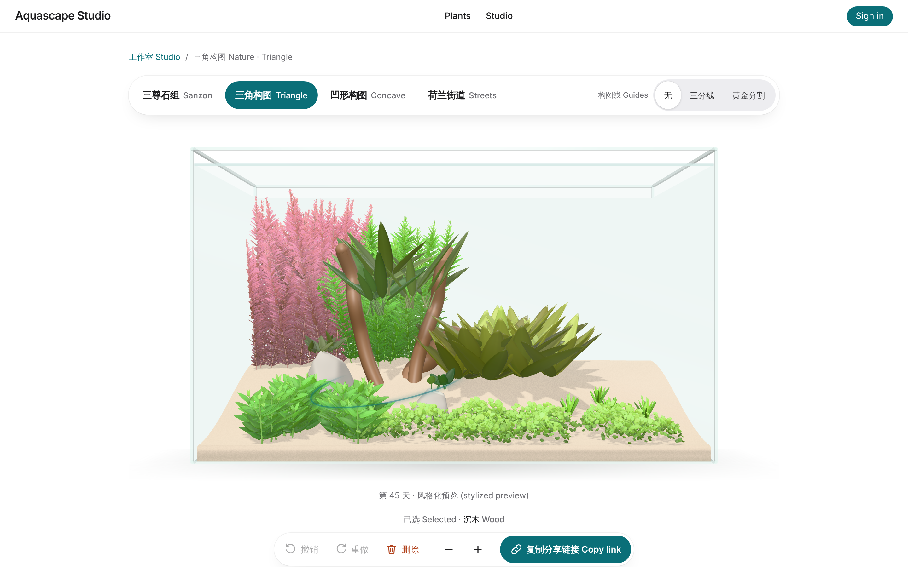

# Iteration log · 2026-11-16 (Pacific Time)

> Theme of this round: **driftwood + resizable hardscape + editor layout fixes**, plus the **regulated species marker** for the plant library. Continues P2 "3D editor": the editor goes from "can only move the rocks in a template" to "can add rocks and driftwood, resize them, and change the driftwood style".

## Checks at start
- Catch-up: `docs/iterations/2026-11-11.md` already exists → skipped.
- No new reply from Xiaopu: the comments asking them to confirm on [studio#7](https://github.com/aquascape-studio/aquascape-studio/issues/7) and [studio#9](https://github.com/aquascape-studio/aquascape-studio/issues/9) got no response → `styleTemplates` and `dragEditor` stay **off**.
- No AWS resource PRs awaiting approval (aquascape-infra has no open PRs).
- On the standing authorization in the ROADMAP that "visual changes no longer wait for confirmation": this round's scheduled-task prompt still requires "visual changes go behind a flag and wait for Xiaopu to confirm", and 11-14 and 11-15 did the same, so this round **was handled conservatively and the flags were not turned on**.

## Research, today's angle: driftwood composition + invasive species regulation
- Driftwood composition rules of thumb (hobbyist / vendor guides, so heuristics): place the main driftwood near an intersection of the 3×3 grid, off-center; wood and rock need a primary and secondary, not an equal split; the main driftwood often takes 40–60% of the tank length; spider wood (spider wood) inverted can imitate riverbank tree roots, and the twig tips can be tied with moss, fig, and chili fig. → The contract gives three styles (branchy / root / log), with default sizes proportional to the tank size (branchy 0.45W, root 0.50W).
  - https://gensou.sg/how-to-use-roots-aquascaping/
  - https://gensou.sg/aquascape-with-driftwood-and-stone/
  - https://terrariumtribe.com/spider-wood-guide/
- The EU Invasive Alien Species of Union concern list (Reg. (EU) 2016/1141) restricts keeping, selling, breeding, and releasing, and includes common aquatic plants such as Cabomba caroliniana; the 2025 revision added Crassula helmsii and Salvinia molesta. → botany adds a `regulated[]` field, with a hint when adding plants.
  - https://eur-lex.europa.eu/eli/reg_impl/2016/1141/oj/eng
  - https://en.wikipedia.org/wiki/List_of_invasive_alien_species_of_Union_concern
- Searching for "Apple-style 3D object resize interaction" found no reliable material (only scroll-driven zoom animations) → resizing starts with the −/+ pill buttons on the toolbar and the keyboard, with no 3D drag handles (gizmos), which also fits the "no gizmo" decision made on 11-15.

## Requirements
Umbrella issue [studio#11](https://github.com/aquascape-studio/aquascape-studio/issues/11); sub-issues [render#12](https://github.com/aquascape-studio/aquascape-render/issues/12), [web#13](https://github.com/aquascape-studio/aquascape-web/issues/13), [botany#13](https://github.com/aquascape-studio/aquascape-botany/issues/13).
User story: in the frontal-view tank, **add driftwood and rocks, adjust their size, switch driftwood styles**, make a natural-style "tree-shaped" driftwood scape, and then see what it grows into after 90 days; when adding plants, know which are regulated in some regions.

## Contracts (orchestrator writes and merges first)
| Contract | Version | PR |
|---|---|---|
| botany schema (zod): optional `regulated[]` (jurisdiction / status: prohibited·restricted·watch / listName / since / citationKey); `visual.leafLengthCm` upper bound 60 → 150 | 0.7.0 | [botany#12](https://github.com/aquascape-studio/aquascape-botany/pull/12) ✅ |
| render FrontalTank: `woodStyle` (branchy / root / log) and style spec; per-piece geometry cache (rebuild only the changed piece, ≤ 8 ms); `clampHardscapeXZ()`; the 11-15 objections become spec (front-half-arc halo, 4px drag threshold, cancel returns the original coordinates) | 1.3.0 | [render#11](https://github.com/aquascape-studio/aquascape-render/pull/11) ✅ |
| web editor: `resize` / `addHardscape` / `setWoodStyle`, `previewBase`, `needsResim()` (hardscape-only changes don't re-run the simulation), share link carries woodStyle and stays compatible with old links | 1.1.0 | [web#14](https://github.com/aquascape-studio/aquascape-web/pull/14) ✅ |

## Results per agent
| agent | model | repo | result | PR |
|---|---|---|---|---|
| botany-agent | sonnet | aquascape-botany | 7 species given `regulated` (11 entries in total): EU Union list (Cabomba caroliniana, water hyacinth Eichhornia crassipes, parrot feather Myriophyllum aquaticum), US federal noxious weeds (Hydrilla, Salvinia auriculata, Limnophila sessiliflora, Hygrophila polysperma), Florida Class I, New Zealand NPPA; **25 species**' leaf dimensions replaced from estimates with sourced values; Vallisneria V. gigantea 60 → 100 cm; version 0.7.1; validate / vitest 16 / pytest 4 pass | [botany#14](https://github.com/aquascape-studio/aquascape-botany/pull/14) ✅ merged |
| render-agent | opus | aquascape-render | Three driftwood styles: branchy (4–7 upward-forking branches + twigs), root (30–45° leaning trunk + root plate + a branch reaching to the other side), log (low and lying horizontal + 1–2 short stumps); rounded, tapering tubes, no bark texture, dark-to-light warm brown gradient; per-piece geometry cache, single-piece rebuild median 0.5–2.3 ms (worst 5.2 ms, threshold 8 ms); also cut rock rebuild from about 14.7 ms to about 2 ms; `clampHardscapeXZ`; drag threshold changed to >4px; halo draws only the front half-arc; 75 tests pass | [render#13](https://github.com/aquascape-studio/aquascape-render/pull/13) ✅ merged |
| app-agent | opus | aquascape-web | Editor 1.1.0 fully implemented (33 new tests, 241 passing in total); −/+ resize on the toolbar (keyboard - / = / +), segmented control "枝状 / 树根 / 横木" ("Branchy / Root / Log") shown when driftwood is selected, the "Add" row gains Rock / Driftwood; hardscape-only changes don't re-run the simulation (verified in the browser); **fixed the three 11-15 layout problems** (template bar sticks below the nav; on mobile the timeline no longer blocks the "Add" row; chips wrap, no horizontal scrolling at 390px width); re-vendored botany (157 species, 7 with regulated markers, and "部分地区管制" ("Regulated in some regions") shown in the add chip's hint and screen reader text); new `scripts/check-dom-equal.cjs`: with the flag off the DOM is exactly identical to main | [web#15](https://github.com/aquascape-studio/aquascape-web/pull/15) ✅ merged |

## Screenshots (day 45) — please have Xiaopu confirm
- render component demo: three driftwood styles side by side (branchy / root / log): 
- render component demo: natural-style scene (root driftwood on the left third line + two rocks + carpet + background stems), desktop: , mobile: 
- /studio/sim (all four flags on, triangle composition, driftwood selected), desktop: 
- Same, mobile: ; template bar sticking after scrolling on mobile: 
- Note: in the triangle composition template most of the driftwood is hidden by the plants behind it, so it looks like just two thick tubes; to see the driftwood styles, look at the two render demo images.

## Deployment
- aquascape-web main `e57d012` (including render `6228590`, botany `9a8885f`) → GitHub Actions [run 43850543829](https://github.com/aquascape-studio/aquascape-web/actions/runs/43850543829): build ✅ deploy ✅ (image pushed to ECR + ECS updated). The earlier run at contract merge, [run 43844551679](https://github.com/aquascape-studio/aquascape-web/actions/runs/43844551679), was also ✅.
- Live https://efferves.live/studio/sim: `styleTemplates` and `dragEditor` are still **off**. Visible live changes: the botany version number in the footer; the new driftwood styles only appear in templates / the editor, so the live default page looks no different (confirmed by DOM comparison).
- ⚠️ Live verification is still not completed: the sandbox fails to access efferves.live (connection refused). Also, dev only runs 01:30–04:00 PT (infra#1).

## Directional decisions and rationale
1. **Keep polishing the editor, don't rush ⌘K / AI**: Xiaopu has not yet confirmed `styleTemplates` + `dragEditor`, so first fix the layout problems known since 11-15, then add the driftwood a natural style needs, giving them one complete thing to look at. ⌘K and AI layout will also need to output the same `ScapeDoc`, so the more complete the editor operations, the more effort saved later.
2. **Resize with −/+ and the keyboard, not 3D handles**: with a fixed frontal view 3D handles are hard to aim at, and they conflict with the "restrained, no gizmo" visual decision.
3. **Hardscape-only changes don't re-run the simulation**: the simulation does not yet read hardscape (no shading / footprint), so a re-run would just wait 0.1–0.3 seconds for nothing; `needsResim` will change when the simulation later accounts for hardscape shading.
4. **The regulated marker is only a hint, not a prohibition**: regulations differ by region and the app does not know where the user is; hint first + do not recommend such species automatically in templates.
5. **Flags stay off**: reasons are in "Checks at start".

## Failures / unfinished
- **botany sources were seen only as search snippets**: WebFetch / curl access to eur-lex, legislation.gov.uk, ecfr, wikipedia, tropica, flowgrow, POWO all failed DNS, so all regulation and leaf-dimension data were read from search result snippets (noted in the bib), and need to be re-verified later in an environment with network access. The US federal entry for Hygrophila polysperma is from a secondary source. Not added because unverified: the UK, Australia, more New Zealand species, other Florida species; also not verified whether Hygrophila polysperma entered the EU list in 2022. About 100 species' leaf dimensions are still estimates.
- **Templates contain regulated species**: the concave composition (Nature · Concave) uses Limnophila sessiliflora and Hygrophila polysperma (both on the US federal noxious weed list) → template contract 1.0.2 tomorrow to replace them, and specify that templates must not use `regulated` species.
- **Driftwood in templates is hidden by plants**: the triangle composition's driftwood box is narrow and tall, and sits behind the stem plants, so from the front only two main trunks are visible → template 1.0.2 fixes this too: the natural-style templates will use the `root` style, larger and moved forward.
- Branchy driftwood's fine twigs are slightly thin, with a bit of a "matchstick" feel; thicken the ends next round.
- No fps data from a real GPU (headless SwiftShader).
- In web, `clampHardscapeXZ` is still a local copy (the test comparing it against render is temporarily skipped) → next round, import it from render and enable that test.
- Contract objections (to handle tomorrow):
  - render: the root lean direction is decided by the seed, which makes composition hard to control → add an optional `leanSide`, or lean automatically toward the middle by x.
  - render: the geometry cache key should include quality.
  - render: in a narrow tall box the lean angle can fall below 30°.
  - render: the web cannot place moss on driftwood branches → needs `hardscapeSurfaceY(h, x, z)`.
  - editor: changing templates must also re-run the simulation (lighting / CO₂ come from the template), so `needsResim` should include templateId.
  - editor: `setWoodStyle` keeps sizeCm, so after switching to log the box is still tall → reset the height to the default proportion when changing style.
  - editor: `addHardscape` allows overlapping existing hardscape.
  - editor: when already over the size limit, enlarging should not turn into shrinking (the agent's implementation makes enlarging a no-op while shrinking is allowed); the contract changes to that wording.
  - The old 1.0.0 decoder does not recognize links carrying woodStyle (the live flag is off, so no impact for now).
- e2e: the umbrella repo's smoke test still asserts the old ink-green home page and was not run.
- Orchestration slip (recovered, no loss): I switched the botany local checkout's branch while botany-agent was using it; the working tree was clean, and I switched back immediately.

## Usage
3 sub-agents: botany sonnet about 5 min, render opus about 22 min, web opus about 39 min. The orchestrator wrote contracts, reviewed PRs, merged, integrated screenshots, and deployed. Total wall clock about 1 hour.

## Suggestions for tomorrow
1. Template 1.0.2: replace the regulated species; natural-style templates use root driftwood and place it in front; render 1.3.1 (`leanSide`, `hardscapeSurfaceY`, thicker twig tips) + editor 1.1.1 (handle the objections above), and web imports `clampHardscapeXZ` from render.
2. Moss / fig / chili fig "tied to driftwood" (epiphytes placed on the hardscape surface).
3. Then start the ⌘K command palette "one-sentence scape generation" (rule-based version, outputting `ScapeDoc`).
