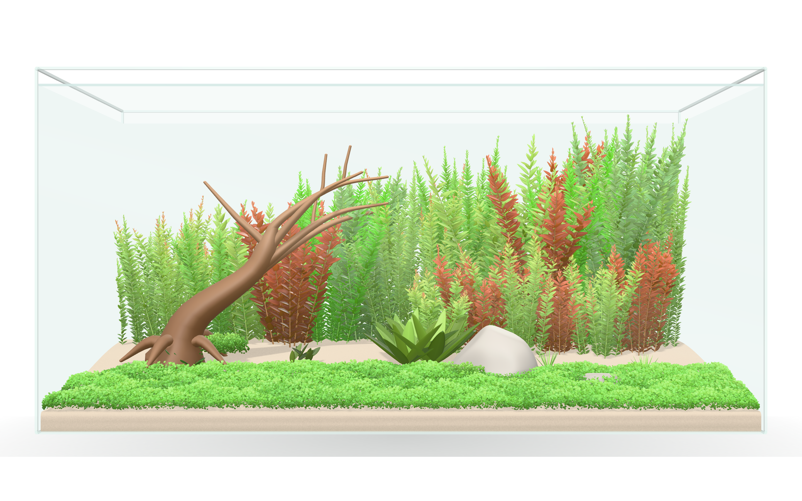
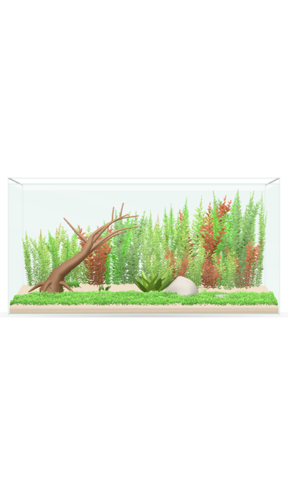
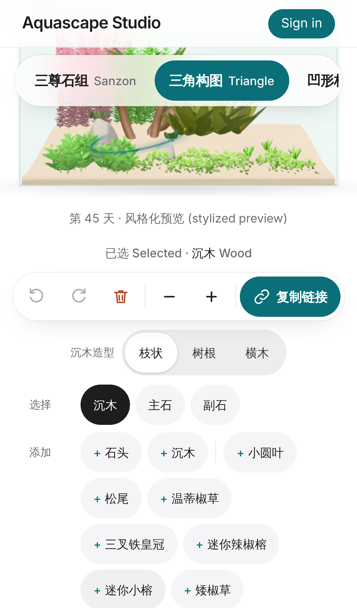

# 迭代日志 · 2026-11-16（太平洋时间）

> 本轮主题：**沉木 (driftwood) + 硬景观缩放 (resizable hardscape) + 编辑器布局修复**，外加水草库的**管制物种标记 (regulated species)**。继续 P2"3D 编辑器"：编辑器从"只能挪模板里的石头"变成"可以添加石头和沉木、调大小、换沉木造型"。

## 开始时检查
- 补课：`docs/iterations/2026-11-11.md` 已存在 → 跳过。
- Xiaopu 无新回复：[studio#7](https://github.com/aquascape-studio/aquascape-studio/issues/7)、[studio#9](https://github.com/aquascape-studio/aquascape-studio/issues/9) 上请他确认的评论都没有回音 → `styleTemplates`、`dragEditor` 继续**关**。
- 没有待批准的 AWS 资源 PR（aquascape-infra 无打开的 PR）。
- 关于 ROADMAP 里"视觉改动不再等确认"的长期授权：本轮的定时任务提示词仍要求"视觉改动先放开关后面，等 Xiaopu 确认"，11-14、11-15 也都是这么做的，所以本轮**保守处理，开关不打开**。

## 调研 (research)，今天的角度：沉木构图 + 入侵物种法规
- 沉木构图经验（爱好者 / 商家指南，属经验法则）：主沉木放在 3×3 网格交点附近、偏离中心；木和石要有主次，不能平分；主沉木常占缸长 40–60%；蜘蛛木 (spider wood) 倒置可模仿河岸树根，枝梢可绑莫斯、榕、辣椒榕。→ 契约里给出三种造型（枝状 branchy / 树根 root / 横木 log），默认尺寸按缸尺寸比例（枝状 0.45W、树根 0.50W）。
  - https://gensou.sg/how-to-use-roots-aquascaping/
  - https://gensou.sg/aquascape-with-driftwood-and-stone/
  - https://terrariumtribe.com/spider-wood-guide/
- 欧盟入侵外来物种联盟清单（Reg. (EU) 2016/1141）限制饲养、销售、繁殖和放生，其中包括 Cabomba caroliniana 等常见水草；2025 年修订又加了 Crassula helmsii、Salvinia molesta。→ botany 加 `regulated[]` 字段，在添加水草时提示。
  - https://eur-lex.europa.eu/eli/reg_impl/2016/1141/oj/eng
  - https://en.wikipedia.org/wiki/List_of_invasive_alien_species_of_Union_concern
- 找"Apple 式 3D 对象缩放交互"没有找到可靠资料（只有滚动驱动的缩放动画）→ 缩放先用工具条上的 −/+ 胶囊按钮和键盘，不做 3D 拖拽手柄 (gizmo)，这也符合 11-15 定下的"不做 gizmo"。

## 需求
总 issue [studio#11](https://github.com/aquascape-studio/aquascape-studio/issues/11)；子 issue [render#12](https://github.com/aquascape-studio/aquascape-render/issues/12)、[web#13](https://github.com/aquascape-studio/aquascape-web/issues/13)、[botany#13](https://github.com/aquascape-studio/aquascape-botany/issues/13)。
用户故事：在正面视角的缸里**添加沉木和石头、调整大小、切换沉木造型**，做出自然风的"树形"沉木景，再看 90 天后长成什么样；添加水草时知道哪些在部分地区受管制。

## 契约（orchestrator 先写并合并）
| 契约 | 版本 | PR |
|---|---|---|
| botany schema（zod）：可选 `regulated[]`（jurisdiction / status: prohibited·restricted·watch / listName / since / citationKey）；`visual.leafLengthCm` 上限 60 → 150 | 0.7.0 | [botany#12](https://github.com/aquascape-studio/aquascape-botany/pull/12) ✅ |
| render FrontalTank：`woodStyle`（branchy / root / log）及造型规范；单件几何缓存（只重建改动的那件，≤ 8 ms）；`clampHardscapeXZ()`；11-15 异议变成规范（前半弧光环、4px 拖动阈值、cancel 返回原坐标） | 1.3.0 | [render#11](https://github.com/aquascape-studio/aquascape-render/pull/11) ✅ |
| web 编辑器：`resize` / `addHardscape` / `setWoodStyle`、`previewBase`、`needsResim()`（只改硬景观不重跑模拟）、分享链接带 woodStyle 且兼容旧链接 | 1.1.0 | [web#14](https://github.com/aquascape-studio/aquascape-web/pull/14) ✅ |

## 各 agent 结果
| agent | 模型 | 仓库 | 结果 | PR |
|---|---|---|---|---|
| botany-agent | sonnet | aquascape-botany | 7 种水草加了 `regulated`（共 11 条）：欧盟联盟清单（Cabomba caroliniana、凤眼莲 Eichhornia crassipes、粉绿狐尾藻 Myriophyllum aquaticum），美国联邦有害杂草（黑藻 Hydrilla、Salvinia auriculata、Limnophila sessiliflora、水罗兰 Hygrophila polysperma），佛州 Class I，新西兰 NPPA；**25 种**叶片尺寸从估计值换成有出处的值；苦草 V. gigantea 60 → 100 cm；版本 0.7.1；validate / vitest 16 / pytest 4 通过 | [botany#14](https://github.com/aquascape-studio/aquascape-botany/pull/14) ✅ 已合并 |
| render-agent | opus | aquascape-render | 三种沉木：枝状（4–7 根上扬分叉 + 细枝）、树根（30–45° 倾斜主干 + 根盘 + 伸向另一侧的枝）、横木（低矮横卧 + 1–2 个短桩）；圆润渐细的管状、无树皮纹理、深→浅暖棕渐变；单件几何缓存，单件重建中位数 0.5–2.3 ms（最差 5.2 ms，阈值 8 ms）；顺手把石头重建从约 14.7 ms 降到约 2 ms；`clampHardscapeXZ`；拖动阈值改为 >4px；光环只画前半弧；75 测试通过 | [render#13](https://github.com/aquascape-studio/aquascape-render/pull/13) ✅ 已合并 |
| app-agent | opus | aquascape-web | 编辑器 1.1.0 全部实现（新增 33 个测试，共 241 通过）；工具条 −/+ 缩放（键盘 - / = / +）、选中沉木时显示"枝状 / 树根 / 横木"分段控件、"添加"行新增 石头 / 沉木；只改硬景观不重跑模拟（浏览器里验证过）；**修了 11-15 的三个布局问题**（模板条吸顶在导航下方；手机上时间轴不再挡住"添加"行；芯片换行，390px 宽无横向滚动）；重新 vendoring botany（157 种，7 种带管制标记，添加芯片的提示和读屏里显示"部分地区管制"）；新增 `scripts/check-dom-equal.cjs`：开关关时 DOM 与 main 完全一致 | [web#15](https://github.com/aquascape-studio/aquascape-web/pull/15) ✅ 已合并 |

## 截图（第 45 天）——请 Xiaopu 确认
- render 组件 demo：三种沉木并排（枝状 / 树根 / 横木）：
- render 组件 demo：自然风场景（左侧三分线上的树根沉木 + 两块石头 + 草毯 + 后景茎草），桌面：，手机：
- /studio/sim（四个开关全开，三角构图，选中沉木），桌面：
- 同上，手机：；手机滚动后模板条吸顶：
- 注意：三角构图模板里的沉木大部分被后面的水草挡住，看起来只是两根粗管；沉木造型要看 render demo 的两张图。

## 部署
- aquascape-web main `e57d012`（含 render `6228590`、botany `9a8885f`）→ GitHub Actions [run 43850543829](https://github.com/aquascape-studio/aquascape-web/actions/runs/43850543829)：build ✅ deploy ✅（ECR 推镜像 + ECS 更新）。契约合并那次 [run 43844551679](https://github.com/aquascape-studio/aquascape-web/actions/runs/43844551679) 也 ✅。
- 线上 https://efferves.live/studio/sim：`styleTemplates`、`dragEditor` 仍**关**。线上能看到的变化：页脚的 botany 版本号；沉木新造型只在模板 / 编辑器里出现，所以线上默认页面看不出区别（DOM 对比确认）。
- ⚠️ 线上验证仍未完成：沙盒访问 efferves.live 失败（连接被拒）。另外 dev 只在 01:30–04:00 PT 运行（infra#1）。

## 方向性决定及理由
1. **继续打磨编辑器，不急着上 ⌘K / AI**：Xiaopu 还没确认 `styleTemplates` + `dragEditor`，先把 11-15 已知的布局问题修掉，再加上自然风必需的沉木，给他一次完整的东西看。⌘K 和 AI 布局以后也要输出同一个 `ScapeDoc`，编辑器操作越全，后面越省事。
2. **缩放用 −/+ 和键盘，不做 3D 手柄**：正面固定视角下 3D 手柄难对准，也和"克制、无 gizmo"的视觉决定冲突。
3. **只改硬景观不重跑模拟**：模拟还不读硬景观（没有遮光 / 占地），重跑只会白白等 0.1–0.3 秒；以后模拟考虑硬景观遮光时再改 `needsResim`。
4. **管制标记只做提示、不禁止**：法规按地区不同，app 不知道用户在哪；先提示 + 不在模板里自动推荐。
5. **开关保持关闭**：理由见"开始时检查"。

## 失败 / 未完成
- **botany 来源只看过搜索摘要**：WebFetch / curl 访问 eur-lex、legislation.gov.uk、ecfr、wikipedia、tropica、flowgrow、POWO 全部 DNS 失败，所有管制和叶片尺寸数据都是从搜索结果摘要里读的（bib 里已注明），需要以后在能联网的环境里复核。Hygrophila polysperma 的美国联邦条目是二手来源。未核实所以没加的：英国、澳大利亚、更多新西兰物种、佛州其他物种；Hygrophila polysperma 2022 年是否进了欧盟清单也没核实。仍有约 100 种叶片尺寸是估计值。
- **模板里有管制物种**：凹形构图 (Nature · Concave) 用了 Limnophila sessiliflora 和 Hygrophila polysperma（都在美国联邦有害杂草清单上）→ 明天出模板契约 1.0.2 换掉，并规定模板不能用 `regulated` 物种。
- **模板里的沉木被水草挡住**：三角构图的沉木盒子窄而高，又在茎草前面，正面几乎只看到两根主干 → 模板 1.0.2 一起改：自然风模板改用 `root` 造型，放大、往前挪。
- 枝状沉木的细枝略细，稍有"火柴棍"感，下一轮加粗末端。
- 没有真 GPU 的 fps 数据（无头 SwiftShader）。
- web 里的 `clampHardscapeXZ` 还是本地副本（与 render 对照的测试暂时跳过）→ 下一轮改为从 render 导入并打开该测试。
- 契约异议（明天处理）：
  - render：树根倾斜方向由 seed 决定，构图时不好控制 → 加可选 `leanSide`，或按 x 自动朝中间倾斜。
  - render：几何缓存键应包含 quality。
  - render：窄高盒子里倾斜角会小于 30°。
  - render：网页没法把莫斯放到沉木枝上 → 需要 `hardscapeSurfaceY(h, x, z)`。
  - editor：换模板时也要重跑模拟（光照 / CO₂ 来自模板），`needsResim` 写进 templateId。
  - editor：`setWoodStyle` 保留 sizeCm，换成横木后盒子还是高的 → 换造型时按默认比例重置高度。
  - editor：`addHardscape` 允许和已有硬景观重叠。
  - editor：已超出尺寸上限时，放大不应变成缩小（agent 的实现是放大为空操作、缩小允许），契约改成这个写法。
  - 旧版 1.0.0 解码器不认带 woodStyle 的链接（线上开关关着，暂时无影响）。
- e2e：总仓 smoke 测试仍断言旧的 ink-green 首页，未运行。
- 编排失误（已恢复、无损失）：我切换了 botany 本地检出分支，当时 botany-agent 正在用；工作区是干净的，立即切回了。

## 用量
3 个子 agent：botany sonnet 约 5 min，render opus 约 22 min，web opus 约 39 min。orchestrator 写契约、审 PR、合并、集成截图、部署。总墙钟约 1 小时。

## 明天的建议
1. 模板 1.0.2：换掉管制物种；自然风模板用树根沉木并放到前面；render 1.3.1（`leanSide`、`hardscapeSurfaceY`、枝梢加粗）+ editor 1.1.1（处理上面的异议），web 改为从 render 导入 `clampHardscapeXZ`。
2. 莫斯 / 榕 / 辣椒榕"绑到沉木上"（附生植物放在硬景观表面）。
3. 之后开始 ⌘K 命令面板"一句话造景"（规则版，输出 `ScapeDoc`）。
