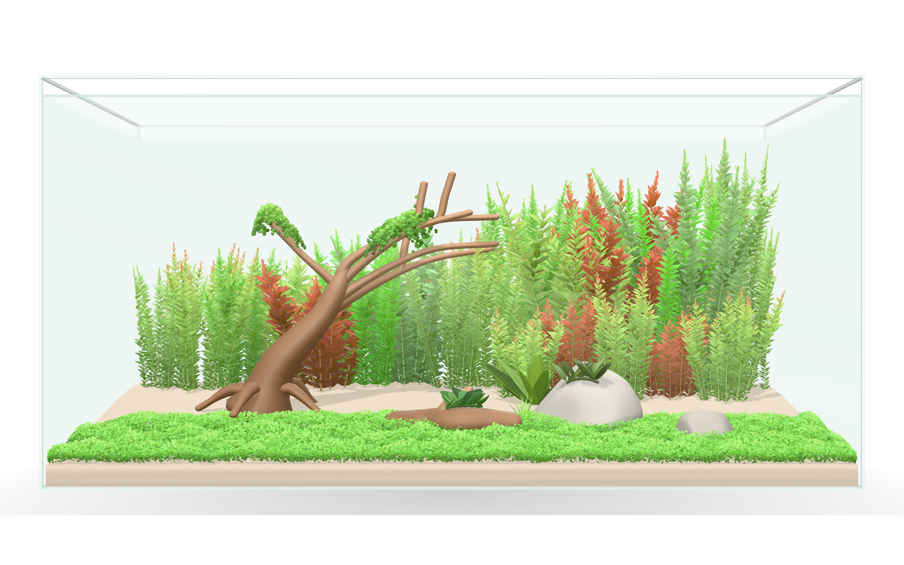
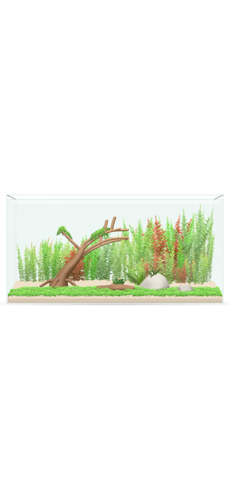
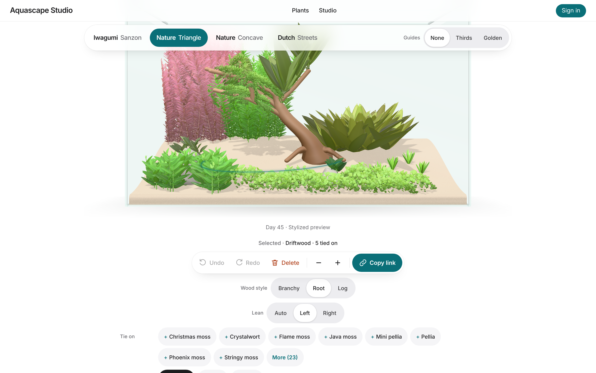
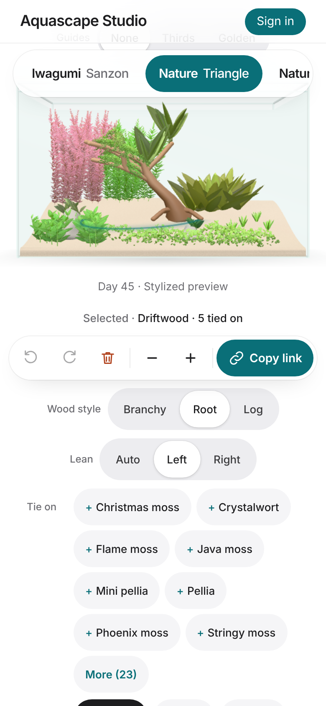

# Iteration log · 2026-11-17 r2 (Pacific time)

> Theme: **epiphytes tied onto driftwood and stones** (moss / Anubias / Bucephalandra / Java fern), plus the 11-16 contract objections. Continues P2 "3D editor". This is the scheduled run; the earlier 2026-11-17 log covers the owner-requested English-only change.

## Checks at start
- Catch-up: `docs/iterations/2026-11-11.md` exists → skipped.
- No reply from Xiaopu on [studio#7](https://github.com/aquascape-studio/aquascape-studio/issues/7), [#9](https://github.com/aquascape-studio/aquascape-studio/issues/9), [#11](https://github.com/aquascape-studio/aquascape-studio/issues/11) (only the orchestrator's own comments) → `styleTemplates` and `dragEditor` stay **off**.
- No comments on the Design canvas (v3 · Ultra-white glass).
- No AWS resource PRs awaiting approval (aquascape-infra has no open PRs).

## Research, today's angle: attaching epiphytes to hardscape
Hobbyist / vendor guides (heuristics, not research), which agree closely:
- The rhizome of Anubias / Java fern / Bucephalandra must stay out of the substrate; tie or glue the plant to wood or rock. Bucephalandra suits where wood meets substrate; Anubias / Buce suit crevices and shaded forks; mosses suit branches. All tolerate low light, which fits the shade driftwood creates.
  - https://gensou.sg/how-to-attach-plants-to-wood/
  - https://aquaessentials.co.uk/blogs/news/how-to-attach-plants-to-driftwood-and-rock-the-right-way
  - https://www.aquasabi.com/aquascaping-wiki_aquatic-plants_epiphytes
- Moss habits: flame moss grows upward, weeping moss hangs, Christmas moss ~5 cm; most mosses grow at low–moderate light.
  - https://aquaticmotiv.com/a/careguides/plants/flame-moss
  - https://gensou.sg/?p=20173
  - https://scaleandstem.pages.dev/plants/aquarium/christmas-moss/

→ Product: when a hardscape piece is selected, offer **"Tie on"** chips (mosses first); anchors prefer forks / upper trunk / log top / stone shoulders; rhizome plants lie on the surface with leaves fanning forward; moss is a cushion that drapes over the surface.
→ The sim already models elevated, non-rooted epiphytes (`PlantPlacement.y`, no substrate uptake), so no sim change was needed.

## Requirements
Umbrella [studio#18](https://github.com/aquascape-studio/aquascape-studio/issues/18); sub-issues [render#16](https://github.com/aquascape-studio/aquascape-render/issues/16), [web#20](https://github.com/aquascape-studio/aquascape-web/issues/20), [botany#16](https://github.com/aquascape-studio/aquascape-botany/issues/16).

## Contracts (orchestrator, merged before the agents started)
| Contract | Version | PR |
|---|---|---|
| render FrontalTank: `hardscapeSurfaceY`, `hardscapeAnchors`, attached epiphyte / moss rendering, root-wood `leanSide` (auto leans towards the centre, always 30–45°), cache key + quality / leanSide, minimum twig radius | 1.4.0 | [render#15](https://github.com/aquascape-studio/aquascape-render/pull/15) ✅ |
| web editor: `ScapeDoc.attach`, `attachPlant` / `detachPlant` / `setLeanSide`, carry / re-seat rules, 11-16 objections | 1.2.0 | [web#19](https://github.com/aquascape-studio/aquascape-web/pull/19) ✅ |
| web templates: no regulated species; Nature templates use root driftwood up front + ≥ 2 epiphyte groups; `attach` | 1.1.0 | [web#19](https://github.com/aquascape-studio/aquascape-web/pull/19) ✅ |
| web editor clarification at integration (see below) | 1.2.1 | in [web#22](https://github.com/aquascape-studio/aquascape-web/pull/22) |

## Results per agent
| agent | model | repo | result | PR |
|---|---|---|---|---|
| render-agent | opus | aquascape-render | `hardscapeSurfaceY` / `hardscapeAnchors` built from the rendered geometry (ray-cast test at ≥ 50 columns per wood style and stone role, error < 0.5 cm); moss cushions follow branches, rhizome plants lie on the surface with leaves forward; no leaf base inside hardscape (tested); root lean measured 31.1–43.4° for aspect 0.3–2; twig tips ≥ 0.35 cm; 114 tests; rebuild per piece 0.75–3.34 ms (budget 8 ms); 60-plant scrub frame 9.8–11.6 ms (main 10.2–10.4), 60 plants with 12 attached ≈ 18–20 ms | [render#17](https://github.com/aquascape-studio/aquascape-render/pull/17) ✅ merged |
| app-agent | opus | aquascape-web | Editor 1.2.0 + templates 1.1.0 complete; seeded property test (5 docs × 4 seeds × 150 random ops, invariants after every op); "Tie on" row (mosses first, 8 + "More"), "Untie", "Lean: Auto / Left / Right"; nature-concave's regulated stems replaced by *Limnophila heterophylla* and *Hygrophila corymbosa* 'Siamensis 53B'; all five 11-16 editor objections fixed, `clampHardscapeXZ` now imported from render; old 1.0 / 1.1 links still decode; flags-off DOM identical to main | [web#22](https://github.com/aquascape-studio/aquascape-web/pull/22) |
| botany-agent | sonnet | aquascape-botany | **Not done**: every data source (eur-lex, ecfr, Tropica, Aquasabi, Flowgrow) is outside this session's allowed network domains, so 0 of 31 records could be verified. All 31 already have `placement: "attached"`. Open question: *Riccia fluitans* is naturally floating — should it keep "attached"? PR closed unmerged (it was only a version bump) | [botany#17](https://github.com/aquascape-studio/aquascape-botany/pull/17) closed |

## Integration (orchestrator)
- The web agent worked against a geometric stand-in (`lib/editor/surface.ts`) because render 1.4.0 was not merged yet. At integration `surfaceY` / `anchors` now delegate to the render exports.
- With real geometry, 12 web tests failed. The fixes, written into **editor contract 1.2.1**:
  1. Branch tips reach past the footprint ellipse, so "the plant is on its host" now means "the host has a surface at (x, z)", not "inside the ellipse".
  2. A rotated branchy piece had anchors **outside the glass**; anchors outside the 1 cm glass margin are ignored when seating.
  3. Seats that miss a thin twig after rounding / glass clamping snap to the nearest surface within 1.5 cm.
  4. A 60-plant template doc on a 90 cm tank encodes to 2004 chars; the 2000 budget stays for the contract's 30-plant doc, and template docs get 2048.
- After the fixes: 298 tests pass, typecheck passes, `next build` passes with flags off and with all four flags on.

## Screenshots (day 45, front view) — please have Xiaopu confirm
- render demo, Nature + epiphytes (moss on root-wood branches, Anubias on a log, Bucephalandra on a stone), desktop: , phone: 
- /studio/sim, all four flags on, Nature · Triangle, root driftwood selected with "Tie on" and "Lean" rows, desktop: , phone: 

## Deployment
- aquascape-web main `a7c63f4` (includes render `065bbfd`, FrontalTank 1.4.0) → GitHub Actions [run 44071662013](https://github.com/aquascape-studio/aquascape-web/actions/runs/44071662013): build ✅, deploy ✅, **verify ✅** — ECS service stable and running image `aquascape-web-dev:a7c63f4…`; `/`, `/studio/sim`, `/plants` on https://dev.efferves.live returned 200 (checked from the GitHub runner).
- Earlier today: contract merge [run 44060077979](https://github.com/aquascape-studio/aquascape-web/actions/runs/44060077979) ✅; CI-check PR [run 44060711930](https://github.com/aquascape-studio/aquascape-web/actions/runs/44060711930) ✅ (first verified deploy, same three 200s).
- Live URL: https://dev.efferves.live/studio/sim. With `styleTemplates` / `dragEditor` off in prod builds, the visible page is unchanged (flag-off DOM is identical to main); the epiphyte work is only visible with the flags on.
- Note: earlier logs called the live site https://efferves.live; the deploy workflow targets the **dev** service (`aquascape-web-dev`, served at dev.efferves.live). There is no prod web deployment in this workflow.

## Directional decisions and rationale
1. **Epiphytes before ⌘K / AI**: Nature-style driftwood without moss and Anubias looks unfinished, and it's the first thing hobbyists do with wood. ⌘K and AI layouts will emit the same `ScapeDoc` (now with `attach`), so finishing the document model first saves rework.
2. **Attachment is explicit (`attach` map), not inferred from position**: with real wood shapes, "inside the footprint" was wrong both ways (branch tips outside, gaps inside). Explicit attachment also makes "drag never silently re-parents" testable.
3. **Real geometry is the single source**: the editor seats plants with the same function the renderer uses to draw the wood, so a tied plant can never float or sink.
4. **Flags stay off**: no reply from Xiaopu yet; the daily task requires confirmation for visual changes.
5. **Added deploy verification to CI** ([web#21](https://github.com/aquascape-studio/aquascape-web/pull/21)): this sandbox cannot reach efferves.live, so the runner now checks that ECS is stable, that it runs the new image, and that `/`, `/studio/sim`, `/plants` return 200 on dev.efferves.live (skipped when dev is scaled to 0).

## Failures / unfinished
- **Botany audit not done** (network policy). To finish it, allow eur-lex.europa.eu, ecfr.gov, tropica.com, aquasabi.com, flowgrow.de, ukaps.org in the environment's network settings. botany#16 stays open.
- **Open contract objections** (for the next round):
  - render: `hardscapeSurfaceY` measures from a flat bed reference through the piece (`bedRef`) rather than the local sloped bed; equal on flat beds — document it in 1.4.1.
  - render: results depend on the sign of `h.x` (auto lean), so dragging root wood across the centre flips its lean — consider freezing `leanSide` when the piece is added.
  - render: a column that hits only a buried part returns y ≤ 0 instead of null.
  - web: migration of old links attaches any lifted plant without checking `canAttach`; `leanSide` is dropped when a piece stops being root wood; templates use 12 anchors per host while the editor uses 8.
  - web: a rotated branchy piece's branches can poke through the back glass (footprint clamp is an ellipse); the clamp should use the real extent.
- *Riccia fluitans* shows up in "Tie on" as "Crystalwort"; it should probably be float-only (botany decision pending sources).
- Rendering cost: 60 plants with 12 attached ≈ 18–20 ms per scrub frame on CPU (headless); no real-GPU numbers yet.
- e2e: the umbrella smoke test still targets dev.efferves.live `/grpc` health, but dev has no ALB / API route; not run.

## Usage
3 sub-agents: render opus ≈ 46 min, web opus ≈ 57 min, botany sonnet ≈ 1.5 min (blocked). The orchestrator wrote contracts, the CI deploy check, the render-swap integration and contract 1.2.1, merged and deployed. Total wall clock about 2 h.

## Suggestions for tomorrow
1. Render 1.4.1 + editor 1.2.2 for the objections above (freeze lean side on add, real-extent glass clamp, sloped-bed reference).
2. Start the ⌘K command palette "one-sentence scape" (rule-based first: style + tank size + light → template + epiphytes), outputting `ScapeDoc`.
3. Botany audit once the network allows the data sources.
