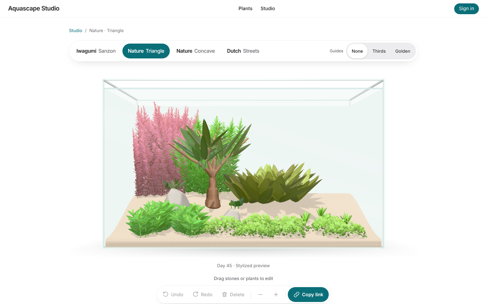
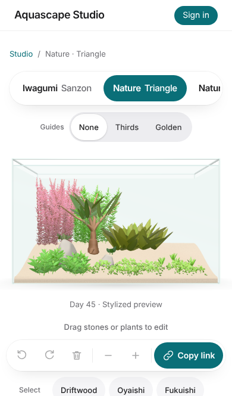
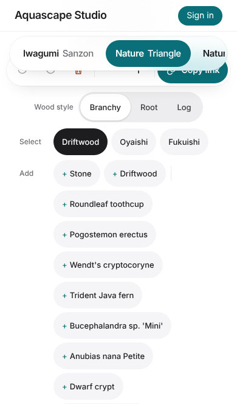
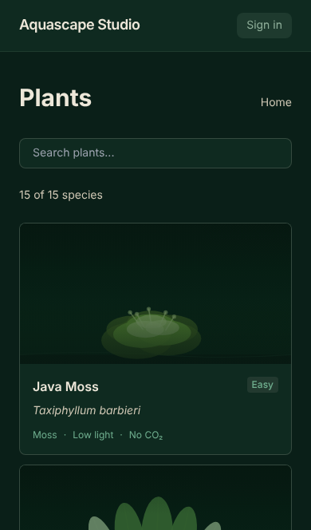

# Iteration log · 2026-11-17 (Pacific time)

> Theme: **English-only**, by direct owner instruction. Not a scheduled feature iteration.

## Owner instructions (this session)
1. Everything public on GitHub is written in English.
2. Translate everything that was already published in Chinese; whatever can't be edited in place gets covered by a new PR.
3. The product itself is English-only too: app UI copy and the plant library's Chinese names.

## What changed
| Repo | Change | PR |
|---|---|---|
| aquascape-studio | `CLAUDE.md` language rule (GitHub + product English-only; only the owner's end-of-run summary stays Chinese) | [#13](https://github.com/aquascape-studio/aquascape-studio/pull/13), [#15](https://github.com/aquascape-studio/aquascape-studio/pull/15), [#16](https://github.com/aquascape-studio/aquascape-studio/pull/16) |
| aquascape-studio | ROADMAP + all iteration logs (11-11 … 11-16) translated | [#14](https://github.com/aquascape-studio/aquascape-studio/pull/14), [#15](https://github.com/aquascape-studio/aquascape-studio/pull/15) |
| GitHub prose | Titles/bodies of studio issues #1, #4, #7, #9, #11; 3 status comments; PR descriptions studio#2, botany#8/#9/#11/#14, render#13, web#2/#5/#9/#12/#15 — edited in place to English | — |
| aquascape-render / web / infra | Chinese code comments translated | [render#14](https://github.com/aquascape-studio/aquascape-render/pull/14), [web#16](https://github.com/aquascape-studio/aquascape-web/pull/16), [infra#2](https://github.com/aquascape-studio/aquascape-infra/pull/2) |
| aquascape-web | Three old commit messages quote Chinese UI copy; history can't be rewritten, so `docs/commit-message-translations.md` gives the English | [web#17](https://github.com/aquascape-studio/aquascape-web/pull/17) |
| aquascape-botany | Schema **0.8.0**: `commonNames.zh` and `pinyin` removed from all 157 species and from the schema (`commonNames` is strict); Chinese trade-name remarks removed from 4 notes; search uses scientific name / English names / id; test guards against CJK characters | [botany#15](https://github.com/aquascape-studio/aquascape-botany/pull/15) |
| aquascape-ui | `PlantChip` loses the `nameZh` prop | [ui#1](https://github.com/aquascape-studio/aquascape-ui/pull/1) |
| aquascape-mobile | Plant list and Settings → Language are English-only | [mobile#1](https://github.com/aquascape-studio/aquascape-mobile/pull/1) |
| aquascape-web | English-only UI: 208 bilingual source lines replaced with single English labels; botany 0.8.0 re-vendored; template contract 1.0.2 (`nameZh`/`blurbZh` removed, `name`/`blurb` in English); CJK font stack removed; `/plants` search in English; guard test `lib/englishOnly.test.ts`; 246 tests, build passes with flags off / prod / all on | [web#18](https://github.com/aquascape-studio/aquascape-web/pull/18) |

Final sweep: 0 CJK characters in issues, PRs, comments and review comments across all 10 repos, and 0 in tracked docs and source (outside vendored sim-core, which has none either).

## Screenshots (all four flags on, day 45, Nature · Triangle)
- Desktop: 
- Phone: ; editor: 
- Plant library (phone): 

## Decisions
- Iwagumi stone roles keep the standard Japanese terms (Oyaishi / Fukuishi / Soeishi / Suteishi) with English tooltips (main / secondary / accent / fill); they are the hobby's English vocabulary.
- The English UI ships directly (owner-requested copy change, not a new visual design). `styleTemplates` and `dragEditor` stay off.
- The Chinese names that were removed remain in git history (botany ≤ 0.7.1) if they are ever needed again.

## Notes / follow-ups
- The daily scheduled-task prompt still asks for "real Chinese trade names" for new species and for Chinese iteration logs; `CLAUDE.md` records that the owner's 2026-11-17 instruction overrides both. The owner may want to update the stored prompt.
- English species names are longer, so the editor's "Add" chips wrap to about one per row on phones (no overflow, just taller).
- The `/plants` page still uses the old dark theme (it never read plants.json); restyle later.
