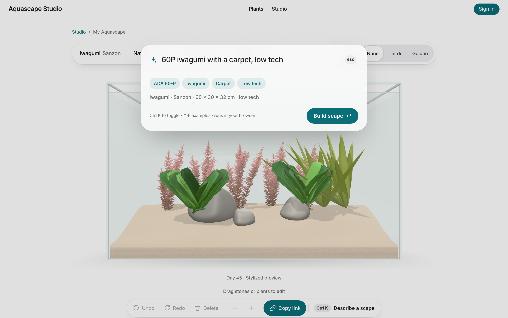
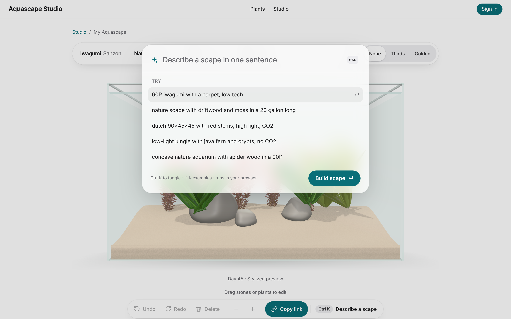
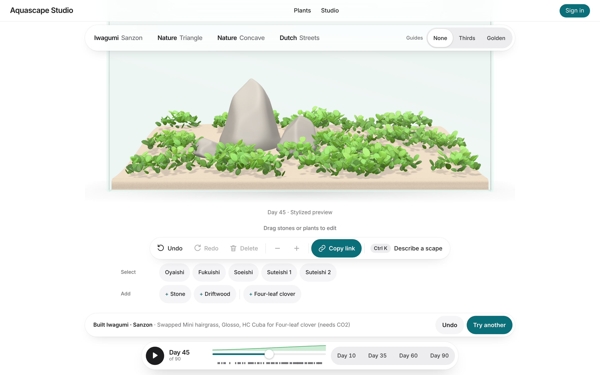
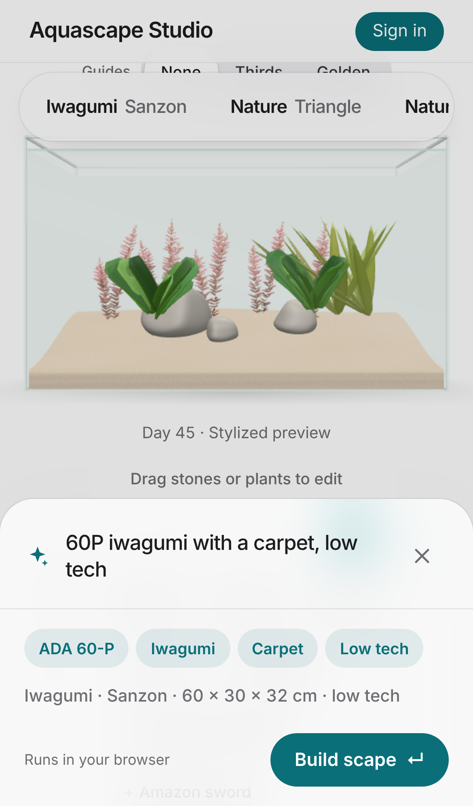
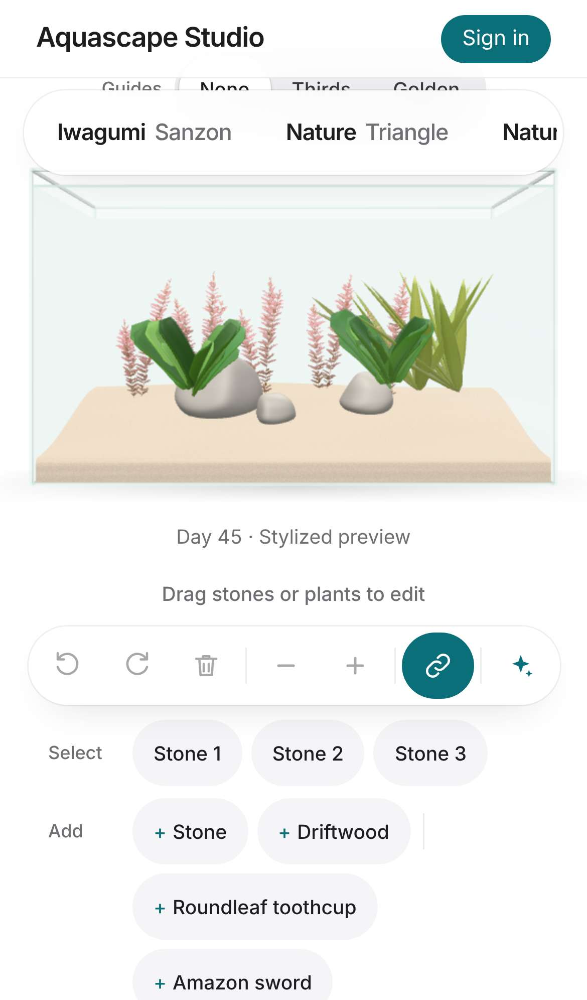
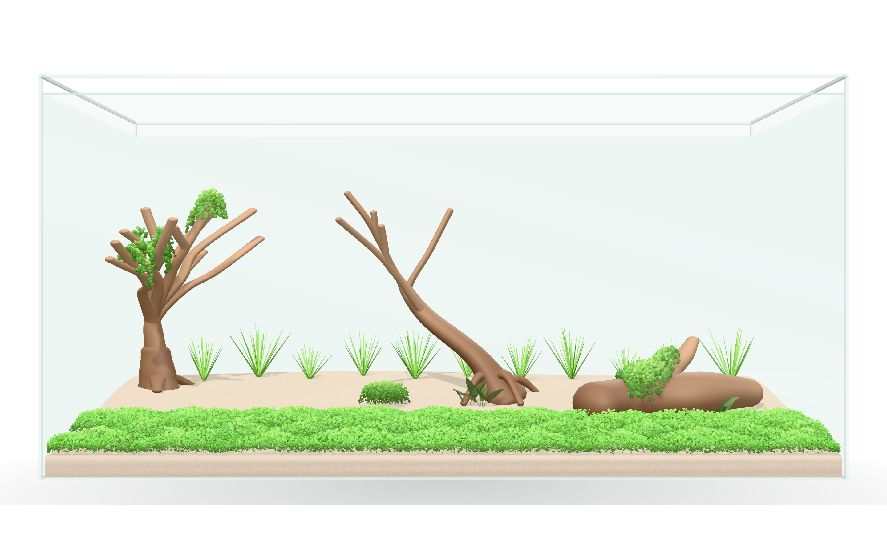

# Iteration log · 2026-11-18 (Pacific time)

> Theme: **⌘K one-sentence scape** (rule-based "describe a scape" → full editable `ScapeDoc`), plus the 11-17 r2 render / editor objections. P2 "3D editor" interaction principle (⌘K command palette), and the first step towards P3 "automatic layout by tank size and style".

## Checks at start
- Catch-up: `docs/iterations/2026-11-11.md` exists → skipped.
- No reply from Xiaopu on [studio#7](https://github.com/aquascape-studio/aquascape-studio/issues/7), [#9](https://github.com/aquascape-studio/aquascape-studio/issues/9), [#11](https://github.com/aquascape-studio/aquascape-studio/issues/11), [#18](https://github.com/aquascape-studio/aquascape-studio/issues/18) (only the orchestrator's own comments) → `styleTemplates` / `dragEditor` stay **off**.
- Design canvas (v3 · Ultra-white glass): no comment threads.
- No AWS resource PRs awaiting approval (aquascape-infra has no open PRs).
- Network: tropica.com, aquasabi.com, eur-lex, ecfr, flowgrow.de, ukaps.org, gensou.sg, dev.efferves.live are still outside the session's allowed domains → botany audit (botany#16) still blocked; no botany agent today.

## Research, today's angle: natural language → layout in design tools
- Prompts are best for broad-strokes generation; the canvas comes back for refinement: https://resources.sticklight.com/blog/the-canvas-makes-a-comeback-why-2026-ai-design-trends-are-re-embracing-visual-control
- Natural language as "just another input method" next to the canvas (prompt as a discrete command, not a chat workspace): https://uxdesign.cc/beyond-conversations-natural-language-as-interaction-influencer-8b39ed123c39
- No special prompt syntax; treat the prompt like a form and show what was understood: https://theuxshop-project.pages.dev/tools/prompt-engineering-for-ux
- Command palette basics (real command inventory first, Esc restores focus): https://open-design.ai/prompts/command-palette/
- Comparable apps: Vivarium: Nature Design (iOS) has a style library and aspect-ratio framing but no generation from a description: https://apps.apple.com/us/app/id6758380171 ; other "aquascape generators" only print text ideas: https://thestoryshack.com/tools/aquarium-aquascape-generator/
- Tank presets: ADA Cube Garden 30-C 30×30×30, 45-P 45×27×30, 60-P 60×30×36, 90-P 90×45×45 (https://aquasabi.com/ADA-Cube-Garden; 120-P omitted, sources disagree); US glass 10 gal 20×10×12 in, 20 long 30×12×12, 29 gal 30×12×18, 40 breeder 36×18×16 (https://aquifarm.com/fish-tank-dimensions-chart/).

→ Product: one sentence ("60P iwagumi with a carpet, low tech") → chips showing what was understood → Enter builds a full scape as **one undo step**, then the user refines by dragging. Rule-based v1 runs in the browser; its `ScapeIntent` is the seam a later LLM front-end (P3) can fill.

## Requirements
Umbrella [studio#20](https://github.com/aquascape-studio/aquascape-studio/issues/20); sub-issues [web#23](https://github.com/aquascape-studio/aquascape-web/issues/23), [render#18](https://github.com/aquascape-studio/aquascape-render/issues/18).

## Contracts (orchestrator)
| Contract | Version | PR |
|---|---|---|
| web compose (new): `ScapeIntent`, `ComposeResult`, tank presets, parse / compose rules (substitution thresholds: co2.min ≥ 10 ppm or difficulty ≥ 4 → "needs CO2"; light.min > 40 → "needs high light"; never regulated), ⌘K UI rules | 1.0.0 | [web#24](https://github.com/aquascape-studio/aquascape-web/pull/24) ✅ |
| web editor: frozen lean side, leanSide removed when leaving root, `canAttach` in migration, 12 anchors per host, `replace` runs migration | 1.2.2 | [web#24](https://github.com/aquascape-studio/aquascape-web/pull/24) ✅ |
| web flag `commandPalette` (`NEXT_PUBLIC_FF_COMMAND_PALETTE`), default off | — | [web#24](https://github.com/aquascape-studio/aquascape-web/pull/24) ✅ |
| render FrontalTank: `hardscapeExtent`, real-extent `clampHardscapeXZ`, `resolveLeanSide`, buried column → null, surface reference | 1.4.1 | [render#19](https://github.com/aquascape-studio/aquascape-render/pull/19) (closed, superseded) → carried in [render#20](https://github.com/aquascape-studio/aquascape-render/pull/20) |

render#19 could not be merged on its own: the existing tests pin the version string and the new exports did not exist yet. The implementation PR was branched from it instead.

**Contract amendment at integration (render 1.4.1)**: render-agent objected that pieces on a sloped bed are seated at the *lowest* bed point under their base (so they never float), not at `bedY(h.x, h.z)`. Drawing attached plants at `bedY(h.x, h.z) + y` would leave them up to 2.2 cm off the surface. Accepted: the reference is the piece's **seat height**. Plants are drawn at `seatY(h) + y`, which equals `bedY(h.x, h.z)` on a flat bed.

## Results per agent
| agent | model | repo | result | PR |
|---|---|---|---|---|
| render-agent | opus | aquascape-render | 1.4.1 complete. `hardscapeExtent` reads a shared shape store, so it causes no extra rebuilds. The clamp is tested over every wood style / stone role × 24 rotations × 4 tanks, with every above-bed vertex ≥ 1 cm − 0.05 inside the glass. `resolveLeanSide` added; buried column → null; anchors y > 0.2. On the sloped-bed test, error is 0.000 cm over 45 anchors. Fixed the flaky 8 ms rebuild test (it now measures CPU time, median of 21, budget unchanged). Wood builder ~10% faster with byte-identical output. 144 tests. Rebuild medians 0.6–4.2 ms; bench60 14.2 ms/frame, and 19.5 ms with 12 attached (unchanged). Package 0.2.0 | [render#20](https://github.com/aquascape-studio/aquascape-render/pull/20) ✅ merged |
| app-agent | opus | aquascape-web | `lib/compose` (parse / compose / species index / example prompts) and editor 1.2.2 done, plus the ⌘K dialog, notes line, toolbar pill and phone sheet. 412 tests, including a ~200-sentence property test. **The agent hit the API 5-hour rate limit** during the final build matrix; the orchestrator finished the builds, the DOM-equality check, the commit and the PR | [web#25](https://github.com/aquascape-studio/aquascape-web/pull/25) |

## Integration (orchestrator)
- web#25 verification: typecheck ✅. 412 tests ✅. `next build` ✅ with flags off, with 4 flags on, and with all 5 on. With 4 flags on and the palette off, `/studio/sim?day=45` is DOM-equal to the base (`scripts/check-dom-equal.cjs`), so with the flag off nothing changes.
- web consumes render 1.4.1 (`resolveLeanSide`, real-extent clamp) directly, so there is no local stand-in to swap.

## Screenshots — please have Xiaopu confirm (flags on; not live)
- ⌘K dialog, desktop, "60P iwagumi with a carpet, low tech" with chips: 
- Empty dialog with example prompts: 
- After Enter, day 45, notes line "Swapped Mini hairgrass, Glosso, HC Cuba for Four-leaf clover (needs CO2)" + Undo / Try another: . The screenshot is scrolled; the tank top is cut off.
- Phone sheet: , toolbar pill on phone: 
- render 1.4.1 demo `?scene=glass` (rotated branchy wood clamped at the back-left glass, with moss): 

## Deployment
- Contract merge (web `300f33a`, flag-off code only) → [run 44280709190](https://github.com/aquascape-studio/aquascape-web/actions/runs/44280709190): build ✅, deploy ✅, **verify ✅** inside the dev window (ECS stable, running the new image, `/`, `/studio/sim`, `/plants` → 200 on https://dev.efferves.live).
- Feature merge (web `788560a`, includes render `4fec0ab` FrontalTank 1.4.1) → [run 44362208097](https://github.com/aquascape-studio/aquascape-web/actions/runs/44362208097): build ✅, image pushed, ECS task definition updated ✅. Verify: **HTTP smoke skipped** because dev was scaled to 0 (09:48 PT, outside the 01:30–04:00 PT window). The new image starts with the next window; tomorrow's run will confirm it.
- Live: https://dev.efferves.live/studio/sim. With `styleTemplates` / `dragEditor` / `commandPalette` off, the visible page is unchanged (flag-off DOM checked equal).

## Directional decisions and rationale
1. **⌘K before AI photo recognition**:
   - The document model (templates + editor + epiphytes) is now complete enough to generate into.
   - A rule-based composer is cheap, deterministic, testable and needs no new AWS resources.
   - `ScapeIntent` is the stable seam: an LLM front-end (P3) later only has to fill the same intent.
2. **Substitute, don't refuse**: "low tech" swaps CO2-hungry species for the closest same-form, same-zone species, and says so in the notes line. This shows the user what changed instead of silently building a scape that would melt in the sim.
3. **One undo step per compose**, "Try another" replaces in place: the user can always get back to their own scape with a single Undo.
4. **Accepted render's seat-height reference** over the contract's original wording: it matches what is drawn, and the alternative would make wood float on slopes.
5. **Flags stay off**: no reply from Xiaopu; the daily task requires confirmation for visual changes.

## Failures / unfinished
- app-agent stopped on an **API rate limit** (5-hour limit); the orchestrator finished. No functional work was lost.
- Phone layout (pre-existing, with `styleTemplates` on): the Guides segmented control overlaps the template bar; a faint "Add" chip shows under the ⌘K sheet. To fix next round.
- The compose result screenshot is scrolled (tank top cut off).
- Compose v1 doesn't set sim light / CO2 from the sentence (species choice only).
- Botany audit (botany#16) still blocked by the network policy; *Riccia fluitans* still appears in "Tie on".
- e2e smoke still targets a `/grpc` route that dev doesn't have; not run.

## Usage
2 sub-agents: render opus ≈ 13 min, web opus ≈ 1 h 50 min (stopped by the rate limit near the end). The orchestrator wrote the contracts, amended render 1.4.1 and finished web#25 (builds, DOM check, PR), then merged and deployed. Wall clock ≈ 2 h of work, spread over the day by the rate-limit pause.

## Suggestions for tomorrow
1. Fix the phone layout of the template / guides bars and the ⌘K sheet. Then ask Xiaopu once more, in a single summary issue, to approve turning on `styleTemplates` + `dragEditor` + `commandPalette` together.
2. Compose 1.1: map "low light" / "CO2" in the sentence to sim parameters (`light.surfacePar`, `water.co2Ppm`), so the time-lapse reflects them.
3. Botany audit once the network allows the data sources.
