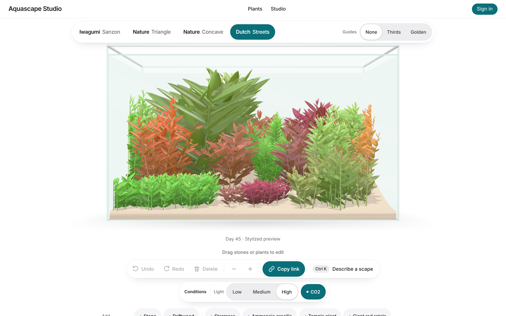
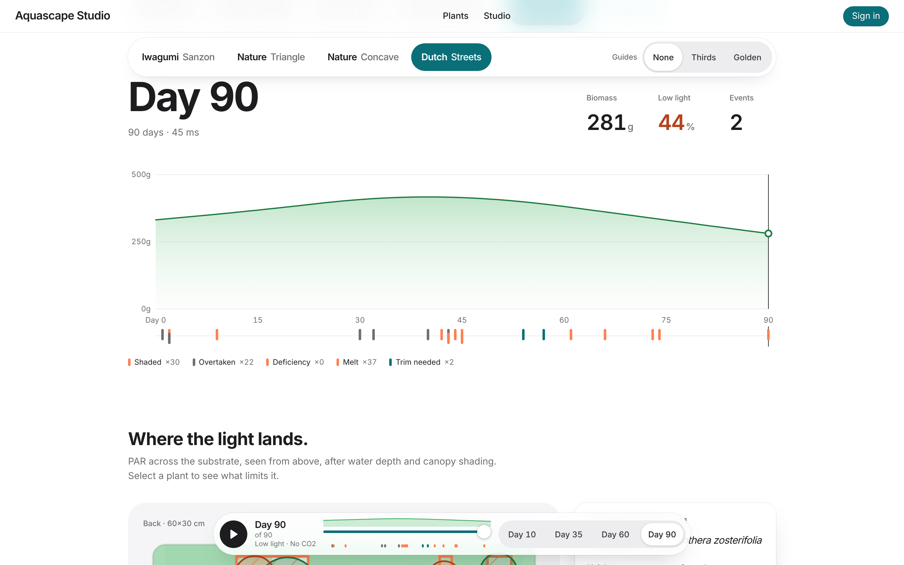
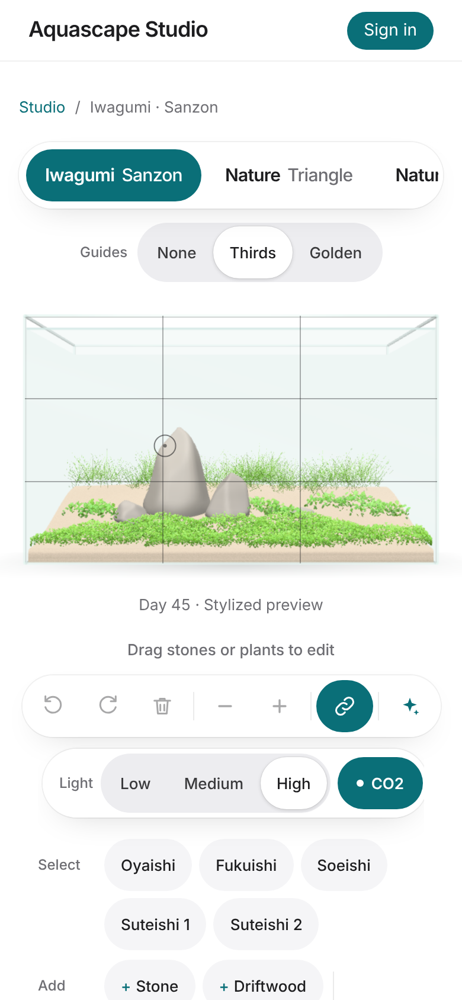
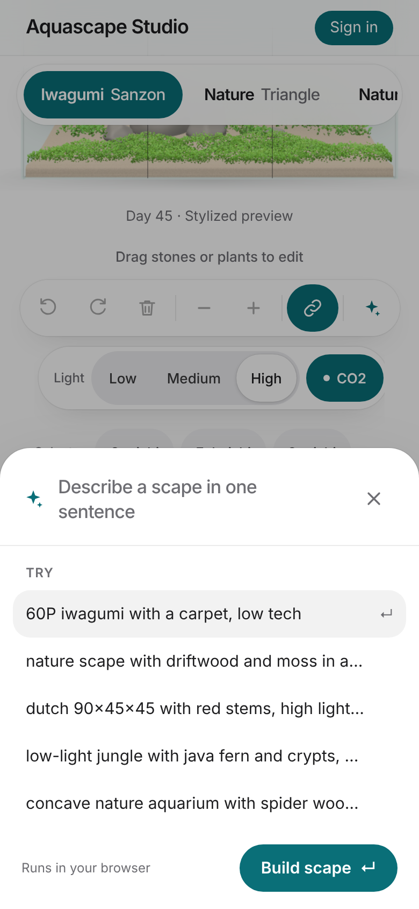

# Iteration log · 2026-11-19 (Pacific time)

> Theme: **Tank conditions drive the time-lapse.** Light level and CO2 are now part of the scape document. The ⌘K sentence ("low-light jungle, no CO2"), the template bar and a new "Conditions" row all set them, and the 0–90 day simulation grows accordingly. Also fixed the phone layout bugs left on 11-18. This touches P1 (growth time-lapse) and P2 (editor).

## Checks at start
- Catch-up: `docs/iterations/2026-11-11.md` exists → skipped.
- Xiaopu has not replied on [studio#7](https://github.com/aquascape-studio/aquascape-studio/issues/7), [#9](https://github.com/aquascape-studio/aquascape-studio/issues/9), [#11](https://github.com/aquascape-studio/aquascape-studio/issues/11), [#18](https://github.com/aquascape-studio/aquascape-studio/issues/18) or [#20](https://github.com/aquascape-studio/aquascape-studio/issues/20). Those issues hold only the orchestrator's comments → `styleTemplates`, `dragEditor` and `commandPalette` stay **off**.
- No AWS resource PRs are waiting (aquascape-infra has no open PRs).
- Yesterday's feature image: today's first deploy ran inside the dev window and verified dev end to end (see Deployment).
- Network: tropica.com and dev.efferves.live are still outside the session's allowed domains → the botany audit (botany#16) is still blocked.

## Research, today's angle: what "low tech" and "high tech" mean in numbers
- PAR bands, retailer guide: low 10–20, medium 20–35, high 40–50+ PAR. It says high light needs CO2 or algae takes over. https://aquariumcoop.com/blogs/aquarium/par-for-planted-tanks
- PAR bands, community wiki (at the substrate): low < 30, medium 31–60, medium-high 61–80, high 81–120. https://reddit.birdcat.cafe/r/Aquariums/wiki/low_tech_planted_guide
- CO2: low-tech tanks sit around 3 ppm (0–1 ppm while the lights are on); high-PAR tanks need about 30 ppm to avoid CO2 limitation. https://www.2hraquarist.com/blogs/beginners-planted-tank-101/do-you-need-co2-planted-aquarium
- Phone sheets rest at fixed detent heights and cover what is behind them (Apple HIG, Sheets). https://developer.apple.com/design/human-interface-guidelines/sheets

→ **Product decision:** light and CO2 are the two levers every planted-tank guide starts with. Yesterday the sentence changed only the species, while the sim kept the template's light and CO2, so what the user typed and what grew disagreed. Today the document carries the conditions. Light stays at three levels (Low / Medium / High) and CO2 is on/off, using the sim's existing mapping (surface PAR 100 / 200 / 320; CO2 off 5 ppm / on 25 ppm). The measured substrate PAR fits the community bands (table below).

## Requirements
Umbrella [studio#22](https://github.com/aquascape-studio/aquascape-studio/issues/22); sub-issue [web#26](https://github.com/aquascape-studio/aquascape-web/issues/26).

## Contracts (orchestrator)
| Contract | Version | PR |
|---|---|---|
| web editor: optional `ScapeDoc.conditions { light, co2 }`, `TankConditions`, `setConditions` op, `effectiveConditions` (doc → template → URL → Medium / no CO2), needsResim, compact link field, template bar sets conditions, "Conditions" toolbar row | 1.3.0 | [web#27](https://github.com/aquascape-studio/aquascape-web/pull/27) ✅ |
| web compose: every composed doc carries conditions (light = stated ?? (low tech → Low) ?? template; co2 = stated ?? (High → on) ?? template); substitution filters use the resolved conditions; "High light without CO2" note; summary ends "Low light · No CO2" | 1.1.0 | [web#27](https://github.com/aquascape-studio/aquascape-web/pull/27) ✅ |

## Results per agent
| agent | model | repo | result | PR |
|---|---|---|---|---|
| app-agent | opus | aquascape-web | Done: • editor 1.3.0, compose 1.1.0, the Conditions row (segmented Light control + CO2 pill with aria-pressed) and the ControlBar label "Low light · No CO2" • ⌘K notes header shows the conditions • phone fixes: Guides moved to its own row, the ⌘K sheet is opaque, the summary wraps • 461 tests (+49) Acceptance: on 60-P Dutch at day 90, High + CO2 gives 736 g and Low + no CO2 gives 301 g (−59 %, threshold 20 %). The contracts were not modified. Two notes (not objections) are in the PR. | [web#28](https://github.com/aquascape-studio/aquascape-web/pull/28) ✅ merged |

## Integration (orchestrator)
- web#28: CI build ✅. The agent ran typecheck ✅, 461 tests ✅ and `next build` ✅ with flags off, timelapse + stylized, and all 5 flags on. With the editor flags off, the `/studio/sim?day=45` DOM is identical to main (97,929 chars), so the visible page does not change.
- Checked that the PR does not touch the contract files (no diff against main after the contract squash), package.json or the lockfile.

### Substrate PAR (light-grid mean, 60-P water column 60×30×32 cm, Dutch doc)
| Light (surface PAR) | Empty tank | Day 0, planted | Day 90, no CO2 | Day 90, CO2 |
|---|---|---|---|---|
| Low (100) | 38.2 | 28.5 | 28.8 | 15.7 |
| Medium (200) | 76.3 | 57.0 | 55.3 | 27.5 |
| High (320) | 122.1 | 91.1 | 102.9 | 69.0 |

The planted values fall inside the community bands. **However, day-90 biomass falls at High light:**

| Light | No CO2 (g) | CO2 (g) |
|---|---|---|
| Low | 300.5 | 1029.6 |
| Medium | 322.5 | 1240.8 |
| High | 149.2 | 736.2 |

A Dutch stem tank with CO2 should not grow less at High light than at Medium. This is opened as [sim#8](https://github.com/aquascape-studio/aquascape-sim/issues/8). Suspects: the upper side of the light envelope, self-shading, or CO2 limitation counted twice. Tomorrow's main task.

## Screenshots — please have Xiaopu confirm (flags on; not live)
- Desktop, Dutch Streets, day 45, Conditions row (High · CO2): 
- Same scape with Low · No CO2, day 90: 281 g, curve peaks around day 40 then declines, melt events: 
- Phone 390 px, template bar + Guides on its own row + editor bars: 
- Phone ⌘K sheet, opaque, nothing bleeding through: 

## Deployment
- Contract merge (web `192815e`) → [run 44501030369](https://github.com/aquascape-studio/aquascape-web/actions/runs/44501030369): build ✅, deploy ✅, **verify ✅** inside the dev window (desiredCount 1, ECS running `192815e`, `/`, `/studio/sim` and `/plants` → 200 on https://dev.efferves.live). This also confirms that yesterday's 788560a feature code (contained in it) runs.
- Feature merge (web `1fbacf8`) → [run 44505862449](https://github.com/aquascape-studio/aquascape-web/actions/runs/44505862449): build ✅, deploy ✅, **verify ✅** inside the dev window (ECS running `1fbacf8`, `/`, `/studio/sim`, `/plants` → 200).
- Live: https://dev.efferves.live/studio/sim. The editor flags are off, so the visible page is unchanged.

## Directional decisions and rationale
1. **Conditions live in the document, not in the URL:**
   - A share link now reproduces the same growth.
   - Undo covers a light change.
   - ⌘K, the template bar and the toolbar all write one field.
2. **Three light levels, not a PAR slider:** matches how the community talks (low / medium / high tech) and the measured substrate bands; a numeric slider can come later.
3. **"Low tech" implies Low light when light is unstated:** keeps the species filter and the sim in agreement (the same rule as compose 1.0.0).
4. **Sim mapping untouched today:** the high-light anomaly is an engine question (sim contract), so it is fixed in sim with a parity check rather than by tuning the web constants.
5. **Flags stay off:** a single approval issue for Xiaopu ([studio#23](https://github.com/aquascape-studio/aquascape-studio/issues/23)) collects the screenshots from 11-14 to 11-19.

## Failures / unfinished
- High-light biomass anomaly ([sim#8](https://github.com/aquascape-studio/aquascape-sim/issues/8)).
- Phone: the CO2 pill touches the right edge of the Conditions row (cosmetic, behind the flag).
- Every template has `co2: true`, so "high light alone → CO2 on" is only unit-tested (on `resolveConditions`).
- Botany audit (botany#16) is still blocked by the network policy.
- The e2e smoke still targets `/grpc`; not run.

## Usage
1 sub-agent: app-agent, opus, ≈ 31 min, 73 tool calls. The orchestrator did research, contracts, issues, review, merges, deploy verification and this log. Wall clock ≈ 1 h 15 min.

## Suggestions for tomorrow
1. sim#8: find out why biomass falls at High light. Fix it in sim-core with a parity check against Python, then re-vendor into web.
2. A light-tolerant template (low tech, no CO2) so the "high light → CO2" rule shows up in compose.
3. Fix the CO2 pill clip on phones. If Xiaopu approves studio#23, turn on the three flags.
