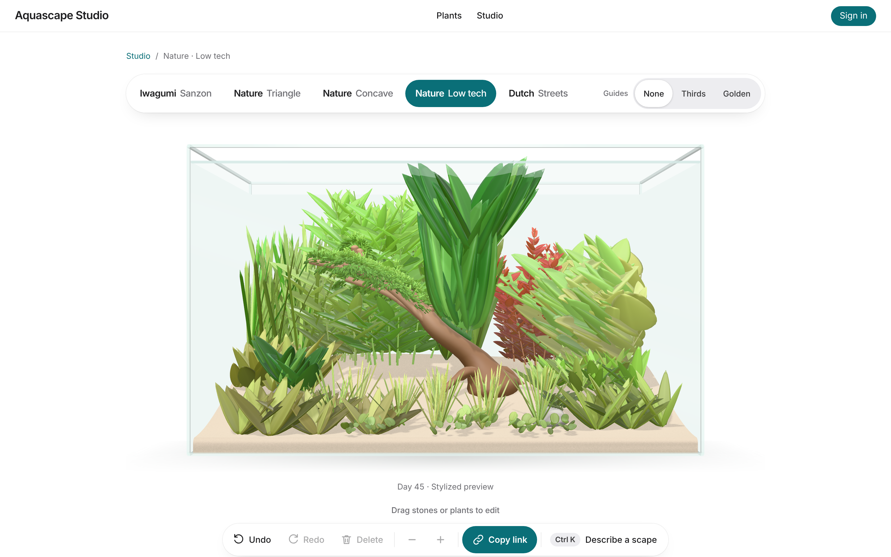
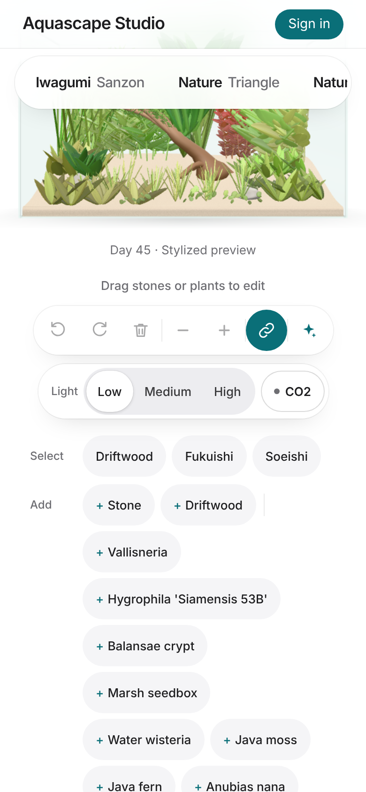
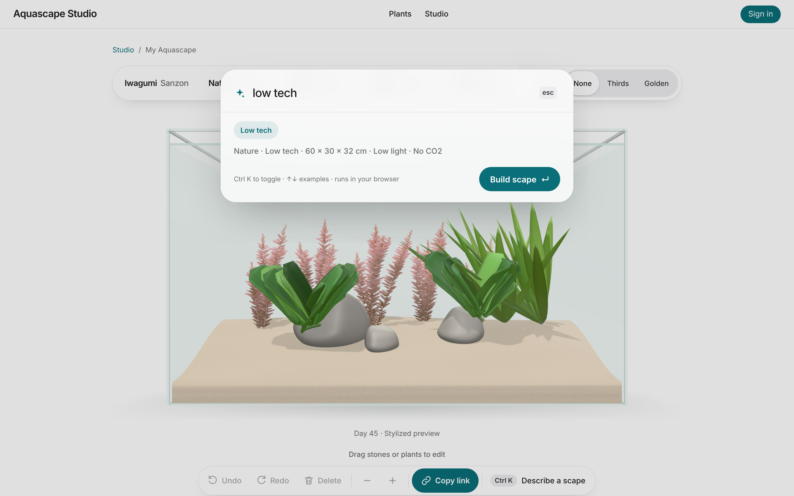
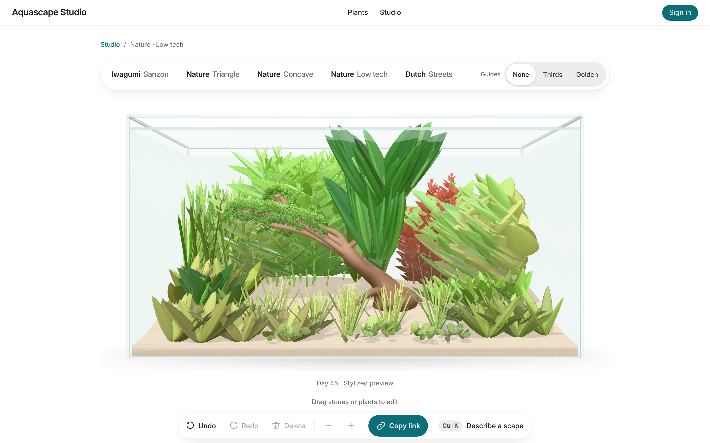

# Iteration log · 2026-11-20 (Pacific time)

> Theme: **High light grows more, not less.** Fixed [sim#8](https://github.com/aquascape-studio/aquascape-sim/issues/8), the bug that made day-90 biomass halve at High light, and added a "Nature · Low tech" template that "low tech" / "no CO2" now picks. This touches P1 (growth time-lapse) and P2 (editor).

## Checks at start
- Catch-up: `docs/iterations/2026-11-11.md` exists, so the catch-up was skipped.
- Xiaopu has not replied on [studio#23](https://github.com/aquascape-studio/aquascape-studio/issues/23), and no studio issue was updated since 11-19. `styleTemplates`, `dragEditor` and `commandPalette` stay **off**.
- No AWS resource PRs are waiting (aquascape-infra has no open PRs).

## Research, today's angle: how plants respond to too much light
- Measured light saturation of submerged macrophytes ranges from about 100 to about 1000 µmol·m⁻²·s⁻¹. Hydrilla, Ceratophyllum and Myriophyllum grown in full sun saturate at 600–700, and Littorella at 850–1000 in vitro. Sources: https://pmc.ncbi.nlm.nih.gov/articles/PMC542304, https://springerlink.bibliotecabuap.elogim.com/doi/10.1007/BF00317353
- High-light photoinhibition in aquatic plants is little studied; most work covers low light. https://pmc.ncbi.nlm.nih.gov/articles/PMC8994855
- Hobby guidance: high light without CO2 makes growth stall and lets algae win. It does not describe plants melting. https://www.2hraquarist.com/blogs/co2-light-relationship and https://aquariumscience.org/index.php/16-2-3-algae-in-low-tech-tanks

→ **Decision:** botany `light.max` is the top of the recommended husbandry range, not a lethal limit. Above it the light score floors at 0.75 instead of dropping to 0.

## Requirements
Umbrella issue: [studio#25](https://github.com/aquascape-studio/aquascape-studio/issues/25). Sub-issues: [sim#8](https://github.com/aquascape-studio/aquascape-sim/issues/8) and [web#30](https://github.com/aquascape-studio/aquascape-web/issues/30).

## Diagnosis (orchestrator)
At High light (surface PAR 320) the tops of tall stems see 230–320 PAR, above most species' `light.max` (120–150). Under ENVELOPE_RULE 1.1.1 the light axis scored 0 there. Fitness is a geometric mean, so a 0 on one axis drags it down (log 1e-3); health then fell and plants melted. The sim agent confirmed this: before the fix, at High light with CO2, 2343 of 3780 plant-days were above `light.max`.

## Contracts (orchestrator)
| Contract | Version | PR |
|---|---|---|
| sim-core: light axis ramps 1 → `LIGHT_UPPER_FLOOR` (0.75) between optMax and max, and stays at 0.75 above max; `LIGHT_RESPONSE_INVARIANTS` | 1.2.0 | [sim#9](https://github.com/aquascape-studio/aquascape-sim/pull/9) ✅ |
| web templates: required `nature-lowtech` (Low, no CO2; species co2.min ≤ 5, light.min ≤ 40, difficulty ≤ 2, unregulated; ≥ 3 epiphyte groups, ≥ 2 crypt groups) | 1.2.0 | [web#29](https://github.com/aquascape-studio/aquascape-web/pull/29) ✅ |
| web compose: a stated no-CO2 / "low tech" with Nature or no style, no composition, and hardscape not none/stone → `nature-lowtech` | 1.2.0 | [web#29](https://github.com/aquascape-studio/aquascape-web/pull/29) ✅ |

## Results per agent
| agent | model | repo | result | PR |
|---|---|---|---|---|
| sim-agent | opus | aquascape-sim | Diagnosis confirmed. Added `LightAxis` and `lightEnvelopeAxis` (the parity port `algo/envelope.ts` is untouched). Built a Dutch 60-P reference fixture from the web's own code. New light-response suite: all 4 invariants hold. 54 tests pass; perf 121 ms cold / 29 ms warm. sim-core 0.2.0 | [sim#10](https://github.com/aquascape-studio/aquascape-sim/pull/10) ✅ merged |
| app-agent | opus | aquascape-web | Added the `nature-lowtech` template (root wood, 2 stones, moss / Java fern / Anubias nana / Buce epiphytes, 5 crypt groups, Vallisneria / Hygrophila back wall, Marsilea carpet; 55 placements on a 60 cm tank). Implemented the compose 1.2.0 rule. Fixed the CO2 pill on phones at 390 and 360 px. 510 tests pass (+49); build passes with flags off and with all flags on; with editor flags off the DOM equals main | [web#32](https://github.com/aquascape-studio/aquascape-web/pull/32) ✅ merged |
| orchestrator | — | aquascape-web | Re-vendored sim-core 0.2.0 (461 tests, typecheck) | [web#31](https://github.com/aquascape-studio/aquascape-web/pull/31) ✅ merged |

### Day-90 total biomass, Dutch 60-P (g), before → after
| | Low (100) | Medium (200) | High (320) |
|---|---|---|---|
| CO2 on (25 ppm) | 1029.6 → 1029.6 | 1240.8 → **1535.2** | 736.2 → **1699.9** |
| CO2 off (5 ppm) | 300.5 → 300.5 | 322.5 → **477.4** | 149.2 → **499.4** |

- CO2 on: High is 1.11 × Medium. CO2 off: High is 1.05 × Medium, a plateau.
- Melt events with CO2 (Low / Medium / High): 11/6/18 → 11/5/4.

### nature-lowtech, day 90 (vendored sim-core 0.2.0)
| Tank | Low · No CO2 | Medium · CO2 |
|---|---|---|
| 60×30×32 (⌘K "low tech") | 2005.9 g (day 0: 1489.8 g) | 3357.3 g |

At Low · No CO2, biomass peaks around day 45, then the foreground under the tall back wall loses a little (dwarf Sagittaria, H. difformis, Marsilea).

## Integration (orchestrator)
- Reviewed each PR: neither touches the contract files; web#32 does not touch `lib/sim/vendor`, package.json or the lockfile.
- The sim engine diff is limited to the new light axis.
- Accepted the app-agent's interpretation: `nature-lowtech` is excluded from the generic style tiers, so it is reached only via a stated no-CO2 (seed rotation for "nature" is unchanged).
- Merge order: sim#9 → sim#10 → web#29 → web#31 → web#32. Submodule pointers bumped: sim `4c45806`, web `c2e6993`.

## Screenshots — please have Xiaopu confirm (all flags on; not live)
- Desktop, Nature · Low tech, day 45: 
- Phone 390 px, Conditions row with the CO2 pill fully inside: 
- ⌘K "low tech", dialog:  → composed: 

## Deployment
All three web deploys ran inside the dev window (01:30–04:00 PT). Each passed build, deploy and **verify** (ECS stable on the new image; `/`, `/studio/sim` and `/plants` → 200 on https://dev.efferves.live):
- contracts `2723535` → [run 44715468051](https://github.com/aquascape-studio/aquascape-web/actions/runs/44715468051) ✅
- sim-core 0.2.0 vendor `ff2e601` → [run 44715949687](https://github.com/aquascape-studio/aquascape-web/actions/runs/44715949687) ✅ (the time-lapse now grows more at High light; live)
- low-tech template + phone fix `c2e6993` → [run 44718550812](https://github.com/aquascape-studio/aquascape-web/actions/runs/44718550812) ✅

Live: https://dev.efferves.live/studio/sim. The editor flags are off, so the only visible change is the engine fix.

## Directional decisions and rationale
1. **Fix the rule, not the data:** `light.max` values come from husbandry guides and are fine as recommendations. The engine was wrong to treat them as lethal.
2. **A floor of 0.75 rather than 1.0:** above the recommended range a plant is still somewhat penalised (bleaching / algae pressure). The invariants pin the behaviour: a plateau without CO2, a gain with CO2.
3. **A real low-tech template rather than substitutions:** "low tech" previously produced a CO2 scape with swapped species. A purpose-built epiphyte + crypt layout matches how low-tech tanks are actually built.
4. **Flags stay off:** Xiaopu has not replied on studio#23. Today's screenshots are added there.

## Failures / unfinished
- **New:** [sim#11](https://github.com/aquascape-studio/aquascape-sim/issues/11), found by the sim agent. The CO2 axis scores 0 below botany `co2.min`, so "no CO2" tanks with demanding stems melt: 35 / 22 / 31 melts on Dutch 60-P. The rate factor ignores 5 vs 25 ppm, because free CO2 is computed from pH/KH as about 31 ppm. This is the same "min is lethal" pattern as the light bug.
- Rotala macrandra has co2.min = 25, which equals the CO2-on value, so it scores 0 even with CO2 on.
- The templates contract's naming "<Style> · <Composition>" doesn't fit "Low tech". Note it in the next contract bump.
- After ⌘K, no template pill is highlighted, because no `?tpl=` is set (pre-existing).
- Botany audit (botany#16) is still blocked by the network policy. The e2e smoke still targets `/grpc` and was not run.
- `pytest` was not run (not installed in the agent sandbox; no Python changed).

## Usage
- 2 sub-agents, both opus:
  - sim-agent: ≈ 4.5 min, 32 tool calls
  - app-agent: ≈ 22 min, 93 tool calls
- The orchestrator handled diagnosis, research, the 3 contracts, issues, review, the vendor bump, merges, deploy verification and this log. Wall clock ≈ 50 min.

## Suggestions for tomorrow
1. sim#11: the CO2 axis gets the same treatment as light (a floor plus consistent free-CO2 from pH/KH), with invariants. Contract 1.3.0.
2. Name rule in the templates contract; highlight the template pill after ⌘K.
3. If Xiaopu approves studio#23, turn on the three editor flags.
