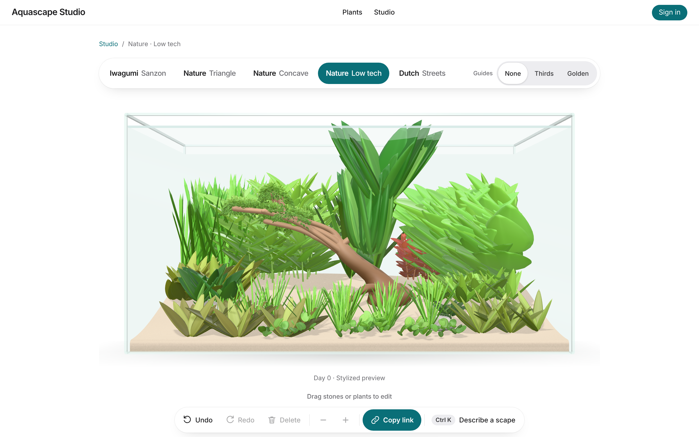

# Iteration log · 2026-11-21 (Pacific time)

> Theme: **"No CO2" grows slower instead of melting.** Fixed [sim#11](https://github.com/aquascape-studio/aquascape-sim/issues/11). The CO2 axis no longer drops to 0 below botany `co2.min`, and the CO2 effect now comes through the growth rate (dissolved CO2) instead of a cliff. Also, ⌘K now highlights the template pill it built from. This touches P1 (growth time-lapse) and P2 (editor). Umbrella issue: [studio#27](https://github.com/aquascape-studio/aquascape-studio/issues/27).

## Checks at start
- Catch-up: `2026-11-11.md` exists, so it was skipped.
- [studio#23](https://github.com/aquascape-studio/aquascape-studio/issues/23) has no reply from Xiaopu. `styleTemplates`, `dragEditor` and `commandPalette` stay **off**.
- No AWS resource PRs are waiting (aquascape-infra has no open PRs).

## Research, today's angle: how much CO2 a non-injected tank holds and what it does to growth
- Typical dissolved CO2 in a non-injected planted tank is about 2–3 ppm. Soil-based tanks reach about 5–6 ppm at best, and hobbyist measurements span 1–6 ppm. Sources: https://www.2hraquarist.com/en-au/blogs/choosing-co2-why/the-wrong-way-to-read-the-ph-kh-chart and https://www.2hraquarist.com/blogs/liquid-carbon-vs-co2. The second is a vendor; its "5–10× faster with CO2" claim is not used.
- Hussner et al. (2016): ten bicarbonate-using submerged species grew **1.1–2.5×** faster under CO2 supersaturation over 35 days. https://kups.ub.uni-koeln.de/26149
- Half-saturation constants for CO2 in macrophytes without a carbon-concentrating mechanism (CCM) are about 7× air equilibrium (Maberly & Madsen 1998, cited in the review at https://academic.oup.com/jxb/article-pdf/68/14/3797/19719837/erx201.pdf).

→ **Decision:** model CO2 as a Michaelis–Menten rate on dissolved CO2, with a 2 ppm baseline for "no injection". Botany `co2.min` is the bottom of the recommended range, not a lethal limit, so the CO2 axis floors at 0.6. The target off/on biomass ratio for a stem-heavy Dutch tank is 0.30–0.75, consistent with the measured 1.1–2.5× stimulation.

## Contracts (orchestrator)
| Contract | Version | PR |
|---|---|---|
| sim-core: `CO2_LOWER_FLOOR` 0.6 at or below `co2.min`; `CO2_RATE_RULE` c/(c+k_co2), c = max(co2Ppm, `CO2_BASELINE_PPM` 2), pH/KH out of the rate factor; `CO2_RESPONSE_INVARIANTS` (5) | 1.3.0 | [sim#12](https://github.com/aquascape-studio/aquascape-sim/pull/12) ✅ |
| sim-core: invariant 1 counts only "lit" melts (placements whose light score never hit 0); for degenerate envelopes (min = max) the low side wins | 1.3.1 | pushed onto [sim#13](https://github.com/aquascape-studio/aquascape-sim/pull/13) ✅ |
| web templates: name is "<Style> · <Composition or variant>"; ⌘K selects the pill for `templateId` (docs only) | 1.2.1 | [web#34](https://github.com/aquascape-studio/aquascape-web/pull/34) ✅ |

Why 1.3.1: the sim agent showed that invariant 1 as written ("melts off ≤ melts on + 2") fails at Low light, 15 vs 11. Every extra melt was a plant already below its `light.min`, which melts from light either way; the CO2 floor only moved 4 of those melts from just after day 90 to days 75–84. The invariant was mis-specified, so the engine was left alone.

## Results per agent
| agent | model | repo | result | PR |
|---|---|---|---|---|
| sim-agent | opus | aquascape-sim | Added `Co2Axis` / `co2EnvelopeAxis` / `co2RateFactor`; the parity port is untouched. New Low-tech 60 fixture built with the web's own code. New `co2-response` suite with 22 tests. 75 tests pass (with 1.3.1); parity error 4.4e-16; perf 88 ms cold / 19 ms warm. sim-core 0.3.0 | [sim#13](https://github.com/aquascape-studio/aquascape-sim/pull/13) ✅ merged |
| app-agent | sonnet | aquascape-web | After ⌘K the pill for `templateId` is highlighted without re-seeding the composed doc. The selection is split into `shown` / `seed`, and Undo restores the pill. 517 tests pass; build passes with flags off and on | [web#36](https://github.com/aquascape-studio/aquascape-web/pull/36) ✅ merged |
| orchestrator | — | aquascape-web | Re-vendored sim-core 0.3.0 (`9fbfc35`): typecheck, 517 tests and build pass | [web#37](https://github.com/aquascape-studio/aquascape-web/pull/37) ✅ merged |

### Day-90 total biomass (g) / melt events, before → after
| Scenario | Light | CO2 off (5 ppm) | CO2 on (25 ppm) |
|---|---|---|---|
| Dutch 60-P | Low | 300.5 / 35 → 547.0 / 15 | 1029.6 / 11 → 1004.8 / 11 |
| Dutch 60-P | Medium | 477.4 / 22 → **806.3 / 2** | 1535.2 / 5 → 1538.1 / 2 |
| Dutch 60-P | High | 499.4 / 31 → **889.2 / 0** | 1699.9 / 4 → 1719.7 / 0 |
| Low-tech 60 | Low | 2005.9 / 32 → 1858.3 / 24 | 2506.6 / 25 → 2430.7 / 25 |
| Low-tech 60 | Medium | 2630.2 / 28 → 2477.3 / 15 | 3357.3 / 20 → 3269.5 / 19 |

- Dutch Medium off/on ratio is 0.52. Low-tech Low off/on ratio is 0.77, so low-tech plants barely care about CO2.
- Rotala macrandra at 25 ppm (its `co2.min`): at High light 0 melts, 84.5 g (was 4 melts, 17.5 g).
- All CO2 invariants and all light invariants pass.

## Integration (orchestrator)
- Reviewed sim#13: the diff is limited to the engine's CO2 axis and rate. `algo/*` and the contract are untouched by the agent. Reviewed web#36: no contract, vendor or package changes, and every new branch is behind `flags.styleTemplates`.
- Merge order: sim#12 → sim#13 → web#34 → web#36 → web#37. Submodule pointers bumped: sim `9fbfc35`, web `024d5b5`.
- Follow-up issues: [botany#18](https://github.com/aquascape-studio/aquascape-botany/issues/18) (CO2 envelopes of floating plants are too narrow) and [web#35](https://github.com/aquascape-studio/aquascape-web/issues/35) (light-starved placements in templates melt; Low-tech 60 has 24 at Low light).

## Screenshot (all flags on; not live)
- ⌘K "low tech" → the "Nature · Low tech" pill is highlighted and the composed scape is intact: 

## Deployment
All three web deploys ran inside the dev window (01:30–04:00 PT). Results are below; the deploy job verifies itself (ECS stable on the new image, and `/`, `/studio/sim`, `/plants` return 200 on https://dev.efferves.live):
- templates contract `b97ab61` → [run 44891973944](https://github.com/aquascape-studio/aquascape-web/actions/runs/44891973944) ✅
- ⌘K pill `0cc468a` → [run 44893438243](https://github.com/aquascape-studio/aquascape-web/actions/runs/44893438243) ⚠️ build, push and deploy succeeded; the verify step failed only because the next deploy (`024d5b5`, which contains this commit) had already replaced the task: "service is not running this commit", with the running image at `024d5b5`. No rollback needed
- sim-core 0.3.0 vendor `024d5b5` → [run 44893576573](https://github.com/aquascape-studio/aquascape-web/actions/runs/44893576573) ✅ (ECS stable on `024d5b5`; `/`, `/studio/sim`, `/plants` → 200)

Live: https://dev.efferves.live/studio/sim. The editor flags are off, so the only visible change is the engine: CO2-off scapes grow slower instead of melting.

## Directional decisions and rationale
1. **CO2 acts through the rate, not a cliff.** This matches the measured growth stimulation (1.1–2.5×) and hobby experience (low-tech tanks grow slowly but do not melt).
2. **Rate on dissolved CO2 only.** The web sends pH 6.8 / KH 4 regardless of CO2, so the pH/KH-derived ~31 ppm made the toggle meaningless. `co2Ppm` is now the single source.
3. **Fix the invariant, not the engine (1.3.1).** Light-starved melts are a template-density issue (web#35), not a CO2 issue.
4. **Flags stay off**, because there is still no reply on studio#23.

## Failures / unfinished
- Back-to-back merges race in the deploy verify (run 44893438243). Suggestion: add a `concurrency` group to the deploy job in web CI so a newer push cancels the older verify.
- The web still sends a fixed pH 6.8 for both CO2 states; physically, 25 ppm with KH 4 is about pH 6.8 and 5 ppm is about 7.5. Harmless now that pH no longer feeds the rate factor; it only affects the pH envelope axis.
- web#35: templates contain placements below `light.min` (Low-tech 60 has 24 melts at Low light).
- botany#18: floating-plant CO2 envelopes.
- The ⌘K Undo path is covered by unit tests only; there was no browser click test.
- The botany audit (botany#16) is still blocked by the network policy. The e2e smoke test still targets `/grpc` and was not run.

## Usage
- 2 sub-agents:
  - sim-agent: opus, ≈ 5.5 min, 35 tool calls
  - app-agent: sonnet, ≈ 17 min, 56 tool calls
- The orchestrator handled research, the 3 contract changes, issues, review, the vendor bump, merges, deploy checks and this log. Wall clock ≈ 45 min.

## Suggestions for tomorrow
1. web#35: a templates contract rule that every placement keeps a light score > 0 under the template's own conditions; fix the back-wall shading in Low tech and Dutch.
2. botany#18: widen floating-plant CO2 envelopes with sources.
3. If Xiaopu approves studio#23, turn on the three editor flags.
